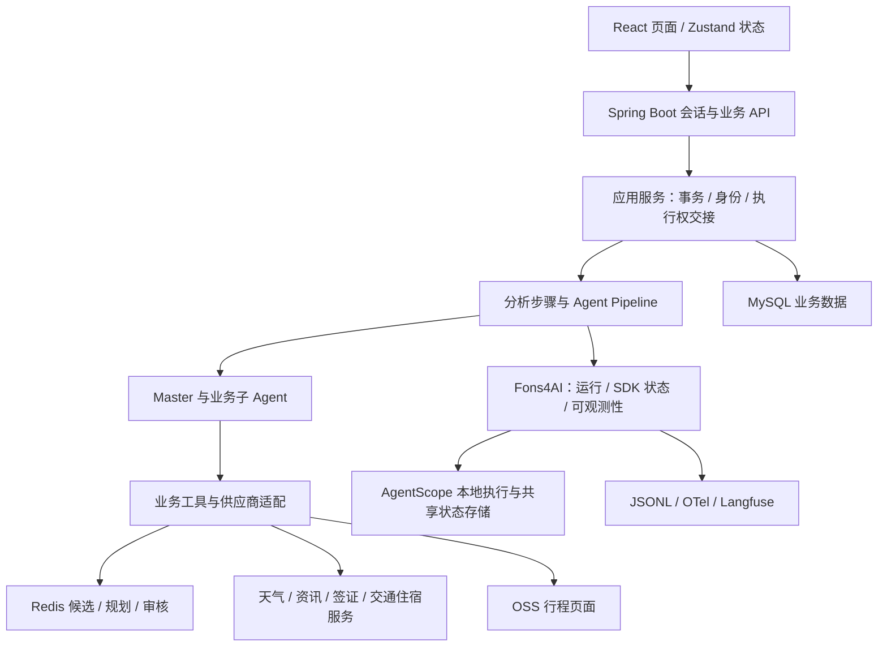
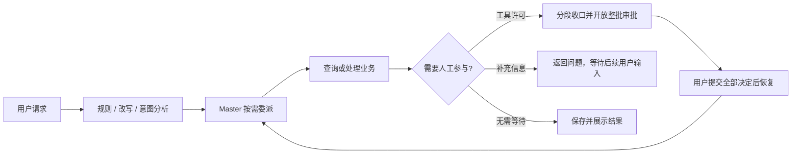

# Trip 智能差旅助手

Trip 面向差旅信息查询、差旅申请管理和行程方案整理，提供对话式入口、工具执行许可和可追踪的 Agent 执行过程。项目参考 LLMentor 中 gogo-agent 的业务场景，当前实现使用 Fons4AI 与 AgentScope 2.0.3；参考工程的能力不自动代表 Trip 已实现的能力。

**[项目地图](docs/wiki/index.md) · [会话执行](docs/wiki/conversation.md) · [Agent 与审批](docs/wiki/agents-and-hitl.md) · [行程规划](docs/wiki/itinerary-planning.md)**

## 当前能力与边界

| 场景 | 已定位的实现与边界 |
| --- | --- |
| 对话与历史 | 登录身份校验、流式响应、首条文本生成标题并持久化、历史读取、空闲会话删除与执行状态查询 |
| 多 Agent 协作 | 规则识别、问题改写、意图识别、Master 与三个业务子 Agent；当前 Master 工具批次配置为顺序执行 |
| 人工参与 | 补充信息与工具执行许可分别处理；审批按分段收口，整批决定后恢复 |
| 差旅业务 | 差旅单查询、创建、修改、取消、审批记录及政策查询；预订能力目前包含关联记录读取 |
| 信息与候选 | 天气、资讯、签证、火车票、机票和酒店/房型查询；可用性取决于实际配置与供应商 |
| 规划与审核 | 基于保存的候选生成往返方案、分维度审核、有限修复、生成已审核 HTML 页面；完整业务验收范围见专题 |

已有代码、编译通过、单个供应商查询成功与完整业务闭环是不同结论。当前不宣称已完成预订 Agent、支付、退改或生产故障自动接管。

## 整体架构



应用服务组织业务一致性，工具适配供应商协议，Fons4AI 承接通用执行与观测。图表示当前依赖关系；调用方向和事务细节分别见各专题。

## 一次需求如何处理



每次请求不必执行全部分析步骤或调用全部子 Agent。详细时序、取消与审批就绪条件见 [会话执行](docs/wiki/conversation.md) 和 [协作与 HITL](docs/wiki/agents-and-hitl.md)，避免将复杂设计堆入本页。

## 运行与开发

后端为 Java 21 / Spring Boot 3.5.8，前端为 React 19 / TypeScript / Vite 8。Node.js 需满足当前 Vite 的 `^20.19.0 || >=22.12.0` 要求，依赖以各构建清单与锁文件为准。

1. 先准备 Fons4Cloud、Fons4AI 的 `1.0.0` 依赖；框架源码和安装说明见 [Fons4AI 仓库](https://github.com/nauyiq/fons4ai)。SDK 同名类补丁的类路径顺序见 [框架接入](docs/wiki/framework-integration.md)。
2. 根据后端 [application.yml](fons4ai-trip-agent-service/src/main/resources/application.yml) 核对数据库、Redis、模型、SDK 状态存储及 OSS 配置。外部供应商凭据按实际启用的工具提供，文档不复制配置中的密钥值。
3. 数据库结构参考 [schema.sql](fons4ai-trip-agent-service/src/main/resources/db/schema.sql) 与 [迁移目录](fons4ai-trip-agent-service/src/main/resources/db/migration/)。这些是仓库定义，不代表测试库已安装同样结构；由用户人工执行所需 DDL/DML，再通过 MySQL MCP 只读验证。
4. 后端由用户启动或重启，可在 IDE 运行 [Main](fons4ai-trip-agent-service/src/main/java/com/fons/cloud/ai/trip/Main.java)，或在服务目录执行下方 Maven 命令。

```powershell
# 在 fons4ai-trip-agent-service 目录：编译生产代码，跳过单元测试编译与执行
mvn "-Dmaven.test.skip=true" compile
# 用户需要启动后端时执行
mvn "-Dmaven.test.skip=true" spring-boot:run
```

前端在 `fons4ai-trip-agent-ui` 目录操作：

```powershell
npm ci
npm run dev
# 静态构建与检查
npm run build
npm run lint
```

前端 `VITE_API_BASE` 默认指向 `http://localhost:8080`，后端端口由 `SERVER_PORT` 控制，默认 `8080`。需要修改时在前端 `.env.local` 设置 `VITE_API_BASE`，不要假定 Vite 配置了 API 代理。开发页面通常由 Vite 提供，实际地址以终端输出为准；已有服务时复用，避免重复启动。

登录使用测试环境中已存在的账号。首次只读请求可检查 SSE、会话标题和历史读取；出现审批卡取决于实际 ASK 规则，不是所有工具默认需要审批。上述命令来自构建入口，本次文档初始化没有执行构建、启动服务或调用供应商。

## 从哪里继续读

- [项目地图](docs/wiki/index.md)：按业务问题查专题、代码和已有测试入口。
- [工程约定](docs/wiki/工程约定.md)：分层、身份、工具、异常和协作边界。
- [AGENTS.md](AGENTS.md)：Agent 的读取路径、技能使用与增量维护要求。

知识基线为 **2026-10-18 的本地工作树**：Trip `feature_front` / `d328b7a` 加未提交改动，框架定位到 `044d783`。详细能力与验证边界集中维护在项目地图和对应专题，不把本地工作树当作已发布版本。
