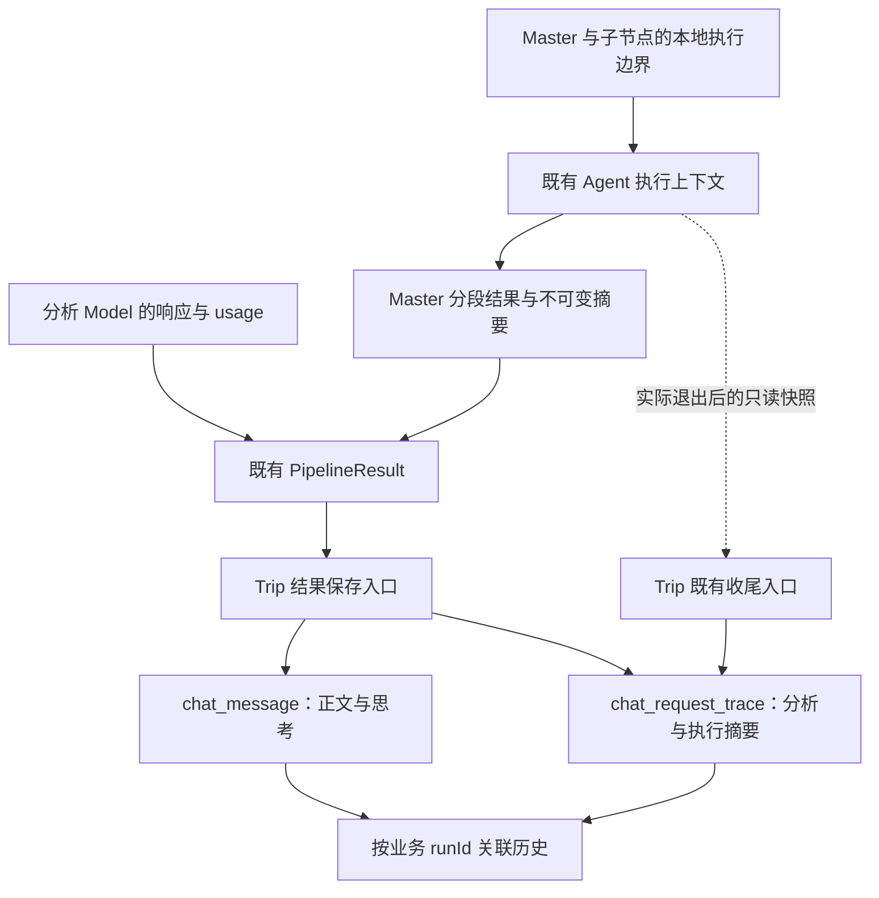
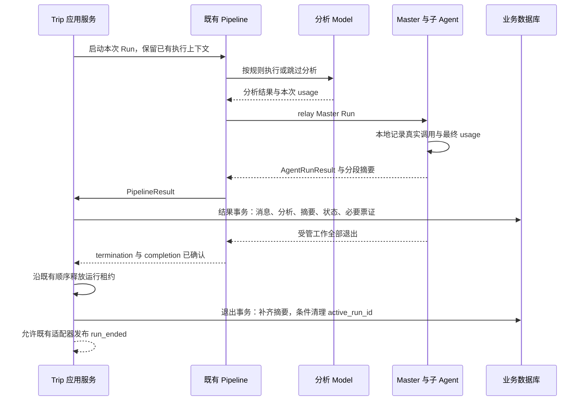
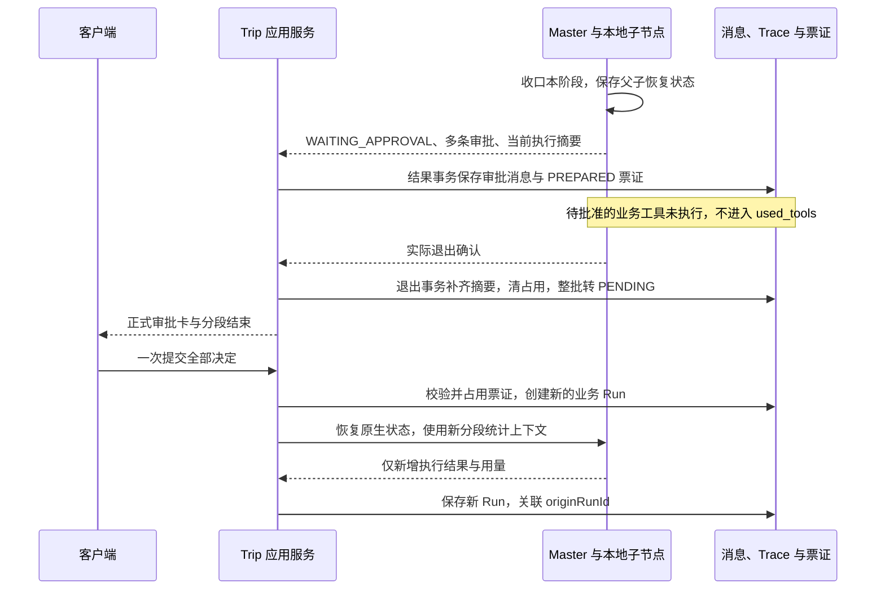
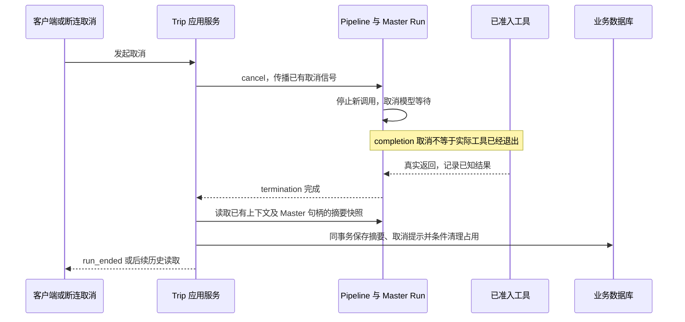

# 请求结果持久化与历史展示 · 技术设计

版本：R2，2026-10-19。依据：[需求说明书](需求说明书.md)。状态：用户已确认基线，源码已对齐；2026-10-20 核心路径最小验收通过，包含联调修复后的审批思考，未覆盖边界及证据集中在任务规划。

## 1. 方案、范围与关键决策

沿用“步骤返回结果 → Master 分段结果 → PipelineResult → 应用保存”的链路。执行期间仅在已有执行上下文中保留有限的调用事实，结束时形成不可变摘要。Trip 决定两表投影与展示，框架不认识数据库表或差旅业务分类。

| 决策 | 本版建议 | 原因与约束 |
| --- | --- | --- |
| D-1 汇总位置 | 使用既有 handleChatResult；真实退出后补齐已知摘要 | 取消可能没有正常 PipelineResult，不能只覆盖成功路径 |
| D-2 分析 Agent | 直接处理 Model 响应，在返回 Msg 的 metadata 保留 usage | 不强制套 Harness，也不增加全局模型代理 |
| D-3 框架结果 | AgentRunResult 增加独立 executionSummary | 失败或没有正文时仍可有统计；不塞入 completeInfo.tools |
| D-4 子节点信息 | 复用既有生命周期上下文，将本地模型/工具事实写回当前 AgentScopeRunContext | 不移除父节点事件过滤，不混合父子正文、审批和状态 |
| D-5 工具执行边界 | 复用现有 ToolExecutor 补丁，增加通过校验后的轻量结果回调 | ToolResult 事件可能表示拒绝或暂停，不能单凭结果开始事件断言实际执行 |
| D-6 存储 | 两表分工；新增一个可空 JSON 列，既有 used_token/used_tools 保留摘要 | 支持未来看板，不增加工具明细表、任务表或统一事件仓库 |
| D-7 展示 | 原历史 API 返回消息及请求摘要，按业务 runId 归组 | 不新增看板或每条消息单独查 Trace 的接口 |

之前讨论的 Pipeline 根采集器、模型装饰代理和统一实时进度快照不采用。观测仍走现有注解/中间件，两条链路不互相调用或依赖出口开关。

## 2. 模块、业务落点与复用

### 2.1 当前事实及来源

核查基线：Trip `feature_front / fe12c55`、Fons4AI `master / 044d783`，均加本地未提交内容；不能将本次新增文件当作这些提交已经包含的功能。

| 模块与实际入口 | 已核实职责 | 本次目标变化 |
| --- | --- | --- |
| [分析 Agent](../../../../fons4ai-trip-agent-service/src/main/java/com/fons/cloud/ai/trip/agent/core/QueryRewriteAgent.java)、[提取工具](../../../../fons4ai-trip-agent-service/src/main/java/com/fons/cloud/ai/trip/infrastructure/util/ExtractUtils.java) | 原先 collectList 后只提取文本；工作树已增加 usage metadata | 保留最后非空 usage，随步骤结果传递；业务解析失败前尽量保留已返回用量 |
| [Pipeline 与上下文](../../../../fons4ai-trip-agent-service/src/main/java/com/fons/cloud/ai/trip/agent/pipeline/AgentExecutePipeline.java) | 顺序分析并 relay Master；工作树已扩展 PipelineResult | 正常返回统一结果；异常收尾只读取同一上下文，不重新启动任务 |
| [应用保存入口](../../../../fons4ai-trip-agent-service/src/main/java/com/fons/cloud/ai/trip/application/conversation/ConversationApplicationService.java) | handleChatResult 保存正文/票证/Trace；streamRun 等待 termination 后交接 | 正常结果先落库，退出事务补齐摘要；保持取消提示和审批交接 |
| [消息与轨迹聚合](../../../../fons4ai-trip-agent-service/src/main/java/com/fons/cloud/ai/trip/domain/entity/ChatMessageAggregate.java) | 映射 analysis_content、used_tools 和状态 | 计算本次用量，按业务工具注册清单分类，构造 JSON |
| [历史读取](../../../../fons4ai-trip-agent-service/src/main/java/com/fons/cloud/ai/trip/application/conversation/ConversationReadApplicationService.java) | 校验会话归属、分页读取消息及审批票证 | 按本页 runId 批量关联请求轨迹，返回 requestTrace |
| [前端 ChatWindow](../../../../fons4ai-trip-agent-ui/src/components/ChatWindow.tsx)、[RequestSummary](../../../../fons4ai-trip-agent-ui/src/components/RequestSummary.tsx) | 工作树已有请求摘要组件及按 Run 判断首条消息的逻辑 | 区分分析与模型思考，处理多消息/多卡/旧记录 |

框架源码位于相邻独立仓库，以下为本工作空间相对路径：

- [AgentRunResult](../../../../../fons4ai/fons4ai-agent/fons4ai-agent-common/src/main/java/com/fons/cloud/ai/agent/model/response/AgentRunResult.java)、[AgentExecutionSummary](../../../../../fons4ai/fons4ai-agent/fons4ai-agent-common/src/main/java/com/fons/cloud/ai/agent/model/response/AgentExecutionSummary.java)：公共结果数据。
- [AgentScopeRunContext](../../../../../fons4ai/fons4ai-agent/fons4ai-agentscope-starter/src/main/java/com/fons/cloud/ai/agent/core/AgentScopeRunContext.java)：当前 Master 分段的调用记录与快照。
- [生命周期中间件](../../../../../fons4ai/fons4ai-agent/fons4ai-agentscope-starter/src/main/java/com/fons/cloud/ai/agent/infrastructure/middleware/AgentScopeExecutionLifecycleMiddleware.java)、[ToolExecutor 补丁](../../../../../fons4ai/fons4ai-agent/fons4ai-agentscope-starter/src/main/java/io/agentscope/core/tool/ToolExecutor.java)：本地节点和真实工具调用边界；两者在本次工作前已是未跟踪文件，本轮继续修改，Git diff --stat 不会完整显示其改动。

组件身份为本地 AgentScope 2.0.3 JAR。已核对 ModelCallEndEvent.getUsage、ChatUsage 输入/输出/缓存字段，以及现有补丁的参数校验、外部工具短路和 callAsync 顺序。公开签名与编译仅证明结构可用；恢复时的事件覆盖和实际加载来源仍需行为验收。

### 2.2 目标职责图



图为目标职责，不表示已有草稿代码已通过全部分支验收。没有新的 Run 调度层或贯穿 Pipeline 的事件采集服务。

<a id="flows"></a>
## 3. 核心流程、时序与状态

### 3.1 普通请求：结果保存与退出补齐



正常完成时快照通常相同，但逻辑终态可能早于已准入工具退出，故退出事务必须重新读取摘要。正文仍使用原权威结果，不将迟到工具文本追加成新的模型正文。

### 3.2 审批与恢复



原 Run 的 analysis_content 不复制成新分析调用；新 Run 没执行的分析字段为空。原分段中的 agent_spawn 等协调执行可保留在明细；待决定的业务工具不因存在审批卡而变成已执行。

### 3.3 取消/失败：没有正常 PipelineResult 的分支



失败分支同样在退出后保存已知摘要，但不在本次新增通用失败提示消息。若 JVM 异常退出导致内存上下文消失，本次不承诺恢复未落库统计；这是已有租约治理之外的能力。

### 3.4 状态、并发和保存不变量

| 当前情况 | 保存/转移条件 | 目标行为与失败处理 |
| --- | --- | --- |
| 普通结果已产生 | 结果处理器取得权威 AgentRunResult | 保存消息和结果摘要，既有状态映射不变 |
| 审批 PREPARED | termination 成功，租约已按原流程释放；票证完整且仍属于本 Run | 退出事务补齐摘要、清占用、整批 PENDING；任一步失败全部回滚 |
| STOPPING | 根、子节点和已准入工具真实退出 | 保存已知摘要与取消提示，清占用；失败不宣告可继续 |
| FAILED/TIMED_OUT | 取得结果或错误，并完成退出确认 | 保存已知摘要；不可将 init 或统计完整性覆盖权威失败状态 |
| 同一收尾被重复订阅 | 同一个 Run 的缓存退出处理链 | 共享一次保存；JSON 全量覆盖为快照，不做数据库累计加法 |
| 旧 Run 清理占用 | 数据库 active_run_id 仍匹配当前 pipelineRunId | 条件更新；不清除后续 Run 的占用，保持已有保护 |

运行时 Map 使用 ConcurrentHashMap 保存不可变调用记录；每次调用生成独立本地 callId。模型结束更新同一项，不因事件转发再创建新项。跨字段原子性只在真实退出后读取最终快照成立；运行中快照仅作已知结果，不声称严格原子。

现有独立后台退出观察和 cache 保留，不能把保存挂到会随 SSE 断连消失的订阅上。不新增 synchronized 锁。数据库摘要写入和占用/票证交接的原子性由既有 TransactionTemplate 事务负责，不由线程安全 Map 保证。

<a id="contracts"></a>
## 4. 接口、消息与执行数据契约

### 4.1 业务身份与调用身份

| 标识 | 来源、作用与去重范围 |
| --- | --- |
| runId | ChatRequestTrace 创建；两表关联、请求统计的主键 |
| pipelineRunId | common-reactor 创建；执行占用、租约和结束事件使用，不代替业务 runId |
| originRunId | 服务端审批票证；仅关联原暂停分段，不合并历史统计 |
| callId | 当前实际模型调用/工具尝试生成的本地 UUID；不是 SDK replyId、toolCallId，也不是 Langfuse spanId |
| agentName | 实际执行节点；仅用于身份说明，不单独作为调用去重键 |

同一工具因框架重试真实调用两次时产生两个 callId。相同流式 usage 或转发事件不产生新 callId。明细按 callId 返回的顺序不代表执行时间顺序，本阶段不提供时间轴或看板排序保证。

### 4.2 框架结果

`AgentRunResult.executionSummary: AgentExecutionSummary?` 由适配器生产，Trip 消费；新增字段保持可空，未支持统计的其他框架实现不能返回伪造空摘要表示零。`completeInfo` 继续负责正文、思考、媒体与原有兼容工具结果，不改其原语义。

| 类型 | 字段与约束 |
| --- | --- |
| AgentExecutionSummary | 目标包含 modelCalls: ModelCall[]、toolCalls: ToolCall[]、usageComplete: boolean；列表构造时复制为不可变 List。完整性取各调用完整性与上游统计覆盖的交集，只允许保守降为 false |
| ModelCall | callId: String；agentName/modelName: String?；inputTokens/outputTokens/cachedTokens: Long?；completed: boolean，表示已观察到本次模型调用结束 |
| ToolCall | callId: String；agentName: String?；toolName: String；status: String；executed: boolean；provider: String? |

`completed=true` 且 usage 非空才表示模型统计完整；usage 字段必须非负。SDK 无来源字段不合成值。工具 status 当前包含 running、success、error、interrupted、suspended、skipped；终态摘要遗留 running 表示结果不确定，不能渲染成功。

实现核查补充：AgentScope 2.0.3 的 ConversationCompactor.summarizePrefix 字节码直接调用 Model.stream；原生压缩/记忆维护可绕过 onModelCall。因此节点装有 CompactionMiddleware、MemoryFlushMiddleware 或 MemoryMaintenanceMiddleware 时，保守设置 usageComplete=false，即使已观察到的调用都有 usage，也只声明已知小计。没有这些维护中间件且全部调用均有有效用量时才可声明完整。框架 INPUT_REQUIRED 的本地固定模型响应明确跳过，不生成供应商调用记录。此处理落实已有保守完整性规则，不新增模型代理或完整维护调用采集。

工作树新增了 `AgentRun.executionSummary()` 作为只读补充入口：不启动任务，取消场景先等 termination 再读取；默认 null 保持其他实现兼容。其必要性是当前取消可能不经过结果处理器，且较早的取消结果不包含迟到工具。本入口建议保留，但列为需用户评审的公共契约扩展，不能升级为全局查询/采集服务。

### 4.3 分析与 Pipeline 结果

分析 Agent 在原 collectList 响应处理处把最后非空 usage 编成 `Msg.metadata["trip.modelUsage"]`，内容为 ModelCall；两个 Handler 在解析业务输出之前取出用量，保存到既有执行上下文。开始执行但没有响应时保留未知状态；规则、缓存、恢复直达不生成 ModelCall。

`PipelineResult` 增加 `executionSummary`，仍包含 pipelineRunId、queryRewriteResult、recognitionResult、masterAgentResult。正常保存读取这个结果；退出补齐从同一上下文读取两个分析结果和 Master 统计，不订阅新模型、事件或 AgentRun.completion 来重执行任务。

若其他适配器不支持 Master 摘要，保留已知分析用量，将聚合摘要 usageComplete 设为 false，不增加模型调用项。目标公共摘要用显式完整性标志承接这一信息；保留两列表的兼容构造方式，由真实调用内容计算默认完整性。当前草稿只有由列表推算完整性的方法，并用 `master-unknown` 占位记录处理，尚需按此调整，见 [待评审差异](#review)。

### 4.4 工具真实执行与业务来源

已有 ToolExecutor 的准入回调继续负责取消/退出计数；新增结果回调只放在工具存在、权限允许、参数校验通过、非外部工具短路之后的 callAsync 入口。回调写入当前 AgentScopeRunContext，不查询数据库。

业务 Guard 的现有短路结果通过 `fons.tool.executed=false` 标明未再次进入业务实现；`fons.tool.provider` 为可选可信结果来源。先处理真实执行，再映射业务 R 失败为 error；不把所有正常返回 Mono 都视作业务成功。

来源白名单：机票/火车票/酒店/房型从已成功结果的 data.provider 提取；天气从 data.source 提取；资讯只有 available=true 才取 data.source。其他来源空缺保留 null。MCP server 名或固定路由配置不自动视作供应商实际返回，本阶段不保证所有外部工具都能提供来源。

目标业务工具分类由 Trip 实际注册的 BaseTool 工具集合及已启用 MCP 工具名决定；内部 SDK 工具不在其中。分类与元数据不得改变原始 R 正文、工具结果、参数注入或许可结果。

### 4.5 聚合伪代码

```text
本次模型调用 = 当前请求实际分析调用 + Master 摘要中的本分段模型调用
每次调用结束时：按本地 callId 替换 usage；不按流片段追加总量

known = 输入和输出 usage 均存在且非负的调用
usedToken = 无调用 ? 0 : known 为空 ? null : sum(input + output)
usageComplete = 统计适配受支持 且 每次调用均结束且有完整 usage

businessToolNames = 实际注册的业务工具名与启用的业务 MCP 工具名
usedTools = distinct(toolName where executed=true and toolName in businessToolNames)
JSON.toolCalls = 完整的已知工具尝试（含内部协调调用、失败与跳过）

结果事务：消息 + 分析 + 请求摘要 + 权威状态 + 必要审批票证
退出事务：重读已知摘要并覆盖摘要列 + 匹配本 Run 的占用清理 + 必要票证交接
```

<a id="storage"></a>
## 5. 两表结构与映射

### 5.1 当前结构和迁移状态

依据 [schema.sql](../../../../fons4ai-trip-agent-service/src/main/resources/db/schema.sql)、本轮 MySQL MCP 只读查询及用户执行反馈：

- 原库已有 chat_message.thinking TEXT、extra JSON；chat_request_trace 已有 used_token BIGINT、analysis_content LONGTEXT、used_tools TEXT、state VARCHAR。
- 用户已于本轮手动执行 [迁移 SQL](../../../../fons4ai-trip-agent-service/src/main/resources/db/migration/20261019_request_execution_summary.sql)。MCP 已核验 execution_summary 为 JSON、IS_NULLABLE=YES，注释一致。
- 迁移已生效不代表新服务已重启，也不代表已验证实际调用数据。

| 目标列 | 类型/空值与约束 | 来源和写入方 |
| --- | --- | --- |
| chat_message.thinking | TEXT 可空，现有列 | Master completeInfo.thinking；ChatMessage.createAgent 映射；多消息 Run 只保留一个展示载体 |
| chat_request_trace.analysis_content | LONGTEXT，可空或含空字段的 JSON 文本，现有列 | queryRewriteResult、recognitionResult；聚合根映射 |
| chat_request_trace.used_token | BIGINT 可空，单位 Token，现有列 | 本次全部模型调用的已知小计，完整性看 JSON |
| chat_request_trace.used_tools | TEXT，逗号分隔去重名称，现有列 | 实际执行业务工具集合；空串表示已知没有，NULL 表示旧/未知数据 |
| chat_request_trace.execution_summary | JSON 可空，新增列 | version=1 的执行明细；旧数据 NULL，不回填 |

本次不加新索引或外键。Trace 仍按 run_id 主键、已有 conversation_id 索引读取；消息到轨迹属于按 runId 的业务关联，不伪称存在数据库外键。

### 5.2 execution_summary v1

根字段：version 固定整数 1；originRunId 可空/可省略；usageComplete 必须为布尔；modelCalls 和 toolCalls 为数组，其结构按 4.2 节。未支持适配的完整性处理需落实 [待评审差异](#review)。未知版本的展示只取已经理解的稳定字段，不把解析错误当作零。

示例数据仅用于说明结构与计算，不是真实生产记录：

```json
{
  "version": 1,
  "originRunId": null,
  "usageComplete": true,
  "modelCalls": [
    {"callId":"model-1","agentName":"queryRewriteAgent","modelName":"example-model","inputTokens":80,"outputTokens":20,"cachedTokens":0,"completed":true},
    {"callId":"model-2","agentName":"InfoAgent","modelName":"example-model","inputTokens":160,"outputTokens":40,"cachedTokens":50,"completed":true}
  ],
  "toolCalls": [
    {"callId":"tool-1","agentName":"masterAgent","toolName":"agent_spawn","status":"success","executed":true,"provider":null},
    {"callId":"tool-2","agentName":"InfoAgent","toolName":"query_weather","status":"success","executed":true,"provider":"example-weather-source"}
  ]
}
```

对应 used_token=300，used_tools=query_weather。以上模型列表假设该示例确实只有两次模型调用，不代表正式普通请求必然只有两次。

### 5.3 写入一致性与异常

handleChatResult 保留现有结果事务：消息、Trace、审批扩展和恢复票证消费按既有语义原子保存。退出补齐只更新 analysis_content、used_tools、used_token、execution_summary，不用聚合根创建时的 init 覆盖数据库终态。

正常、审批、取消、失败的退出补齐与数据库执行权交接置于同一事务。保存失败回滚清占用/开放票证；沿现有错误事件和日志暴露失败，不重放工具。数据库条件更新继续检查 runId/conversationId 和 active_run_id 的既有归属；本次不增加全量业务写入 fencing 或自动接管。

同一 Run 的 JSON 为快照覆盖，不做 `used_token = used_token + ...`；因此重复保存不重复累加。取消系统消息仍复用既有缓存收尾，只新增一条，不因读摘要再创建一条。

<a id="interaction"></a>
## 6. 历史 API 与交互

继续使用 `GET /api/conversation/{conversationId}/messages`。服务端先从登录身份确认归属，分页读取消息，然后以 conversationId + 本页去重 runId 批量查询 Trace。缺少 Trace 的消息仍返回，requestTrace=null；不逐条查询，不向客户端开放任意 runId 跨会话读取。

MessageInfo 新增 runId 和 requestTrace。requestTrace 由 RequestTraceInfo 投影：runId、state（现有枚举 code）、usedToken（可空）、usedTools（数组）、analysis（JSON 对象，可空）、executionSummary（v1 对象，可空）。消息本身继续返回 thinking、extra、审批票证和正文类型，原消费者可忽略新字段。

展示规则：

1. fetchMessages 沿已有分页读完整会话，保持后端顺序；当前已加载消息中，按 runId 第一次出现的位置展示一个可折叠请求摘要，通常位于用户消息之后。
2. 同 Run 的正文、媒体和多张审批卡不重复渲染请求摘要。重复 SSE/历史合并仍按 messageId；请求摘要按 runId，不按时间或文本归组。
3. 分析阶段实时事件携带 agentName/kind=analysis，使用“分析过程”；Master thinking 仍使用模型思考标签。刷新后从 analysis_content 展示结果，不恢复每句“正在……”提示。
4. Master 思考保存到 ChatMessage.createAgent 返回列表中的第一条 TEXT 类型 Agent/AgentHitl 消息，其他消息 thinking 为空。该载体合并写入 extra.thinkingAgentName=masterAgent，保留已有 extra 内容；不能因为审批卡属于子 Agent，就将 Master 思考标为子 Agent 来源。普通消息使用原思考组件；审批批次在第一张卡上方渲染这份思考一次，决定按钮及提交协议保持原样。无思考不添加此元数据；旧记录未有来源元数据时沿原兼容展示，不反推历史来源。
5. 旧记录没有 executionSummary 时，不显示“本分段未执行业务工具”或“0 Token”作为推断；既有 used_tools 如需显示，标为“历史工具记录”，不能把旧 agent_spawn 宣称为业务工具。未知用量显示未知，部分小计显示不完整；无 thinking 不显示空思考框。
6. 请求中、刷新失败、401/归属失败继续使用现有加载/错误处理；摘要缺失不开放审批、不解除占用。新恢复 Run 单独展示本分段概况，原分析只在原 Run 展示。

<a id="release"></a>
## 7. 发布、兼容与风险边界

1. 用户已执行新增可空列，MCP 已确认；代码回退可保留该列，暂不安排删列或历史回填。
2. 框架 common 与 starter 必须成套安装/消费。本地版本仍为 1.0.0，不能只看版本判断运行内容；记录本次构建日志，并在重启后核对实际补丁类来源。旧进程不能热加载新 JAR。
3. 框架已对 ToolExecutor 同名最小补丁做启动校验，本次新增 RESULT_INTERCEPTOR_ATTRIBUTE 也需校验。SDK 升级时重新核查，不仅靠存在同名方法认定兼容。
4. 用户确认 R2 实施基线后，先处理第 9 节差异，再重新完成受影响构建；由用户重启后端，复用前端执行最小联调。
5. 本轮文档重写不启动后端、不请求供应商、不提交审批、不修改数据库。后续手工验证按 T-5 的范围与当前用户约定推进。

摘要会随现有会话删除一起逻辑删除 Trace；不顺带清理 Langfuse、SDK checkpoint 或 OSS。仅保存必要身份/统计和返回来源；不保留工具完整参数、提示词、供应商响应、账号密钥或恢复凭证。

<a id="verification"></a>
## 8. AC 覆盖与验证

以下为待执行的行为验收设计；已运行的构建和迁移检查见任务文件，二者不能替代此表。

| AC | 设计落点 | 前提、动作、预期与证据 |
| --- | --- | --- |
| AC-1 | 分析 metadata、PipelineResult、analysis_content、历史投影 | 新请求确实经过分析，完成后刷新；页面两项结果与 MCP 读取的本 Run analysis_content 一致 |
| AC-2 | ChatMessage 思考载体、历史映射及审批分支 | 有真实思考/无思考两种已知配置；普通完成和双卡暂停后刷新，各仅显示实际产生的一份思考，DB 字段一致 |
| AC-3 | 实际工具回调、Guard 跳过元数据、业务清单分类 | 只读子查询，另验失败/待批准/短路；对照 JSON 明细和 used_tools，无内部工具混入且执行次数可解释 |
| AC-4 | 每调用更新、用量合计与完整性 | 用真实供应商有效 usage 对照每项求和；核对流式累计没有重复，取消缺失用量不是零；规则/恢复跳过分析无新用量 |
| AC-5 | 来源白名单、最小 JSON | 一次有明确来源的只读查询及无来源分支；MCP 核对 provider 仅来自结果，错误/日志和 JSON 不含凭据/完整响应 |
| AC-6 | 三种收尾时序、originRunId、原票证状态机 | 双审批恢复后新旧 Trace 分离；模型中/工具中取消后等 IDLE 再刷新，已知摘要保留且无后台新增工具 |
| AC-7 | 业务摘要独立于 Trace 开关 | 用户重启加载关闭观测的配置后执行同类最小请求，业务表和展示仍有摘要；无 Langfuse 依赖调用 |
| AC-8 | 历史鉴权、批量读取、前端按 Run 首次展示 | 翻页跨一个多消息 Run、读旧会话、用另一测试用户访问；每 Run 一份摘要、旧字段安全、越权仍拒绝 |

不新增/运行单元测试。需要调用真实模型或工具的验收只能在用户确认本版、服务重启且环境就绪后进行；用 Mock 返回值证明供应商语义不可取。

<a id="review"></a>
## 9. 评审时差异与当前实现对齐

以下保留 R2 评审时的差异及目标，用户确认后已进行源码调整；是否满足业务验收仍以任务文件证据为准。

| 项目 | 当前工作树事实 | 目标/建议与影响 |
| --- | --- | --- |
| 公共摘要查询 | AgentRun 增加 executionSummary()；Pipeline 上下文保留 Master 句柄，应用可在退出后读取 | 建议保留此只读补充入口，专门覆盖取消迟到结果；范围小于根级采集器，但确实是公共契约变化 |
| SDK 工具回调 | 在既有 ToolExecutor 补丁中增加结果拦截器，并扩展现有生命周期中间件 | 建议保留实际调用边界，避免基于 ToolResultStart 猜执行；需核对 SDK 升级兼容和生产加载来源 |
| 业务工具分类 | setExecutionSummary 仅过滤 agent_ 前缀和 todo_write | 尚不满足内部文件/其他 SDK 工具不混入的目标；建议使用 Trip 注册工具及启用 MCP 名清单，不新增全局分类平台 |
| 未支持统计的适配 | Pipeline 使用 master-unknown ModelCall 占位 | 会把“统计缺失”与“真实模型调用”混淆；目标增加显式完整性标志，由聚合层保守降为 false，不新增虚假调用 |
| 审批思考载体 | ChatMessage.createApproval 仍在每张卡复制 thinking；卡片渲染分支未展示这段思考 | 尚不满足 AC-2；按第 6 节固定首条 TEXT 载体、思考来源及批次上方展示，保留整批决定交互 |
| 供应商覆盖 | 当前只从成功 R 白名单提取来源，MCP 工具及失败请求不一定有来源 | 与“有证据才记录”一致；本版不保证全覆盖，不根据固定路由补造已返回来源 |
| 数据鲁棒性 | 新历史投影直接解析存量 JSON；usage 入口未统一校验负值 | 需局部容错并区分未知；不能因一条历史摘要坏数据导致整页不可读，也不能累计无效 Token |
| 验证状态 | 框架安装、Trip 生产编译、UI 构建已通过；DDL 已核验；新请求未联调 | 仅能声明结构与迁移检查通过；恢复、取消、多卡和实际工具统计仍未验收 |

源码对齐记录：业务工具分类已改用 MasterAgentConfig 从实际 Toolkit 构造的 TripToolCatalog；未知统计已改用显式完整性标志；审批思考已改为首条 TEXT 载体及批次上方展示；历史摘要解析增加容错和版本检查，负用量归为未知。本地固定响应与原生维护的统计边界见第 4.2 节。此前差异不删除，供对照评审原因；当前构建、部署和行为状态集中记录在 [任务规划](任务规划.md)。
