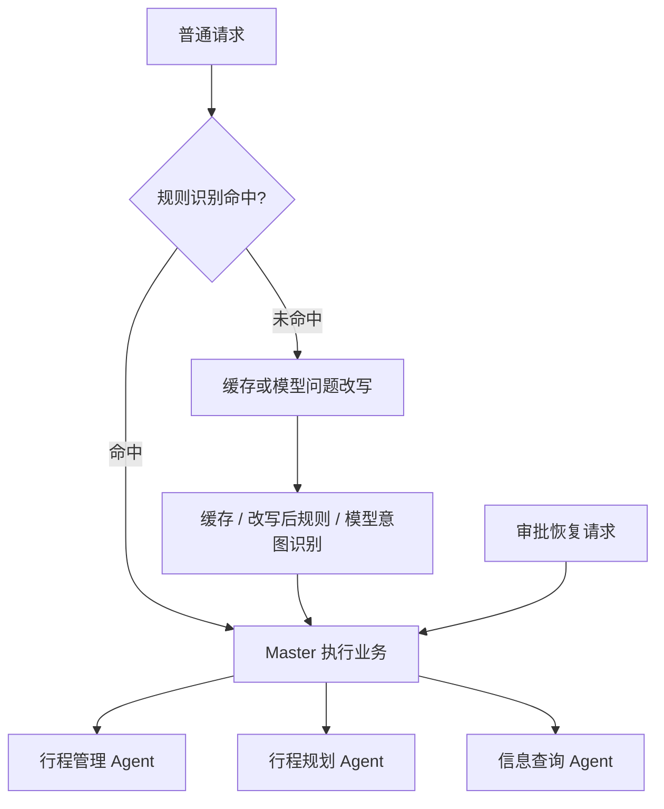
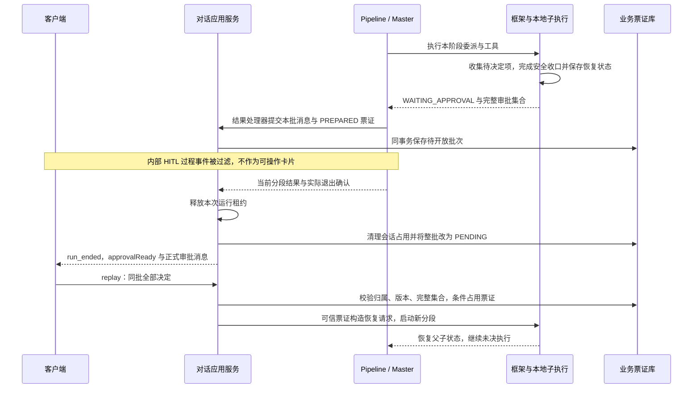
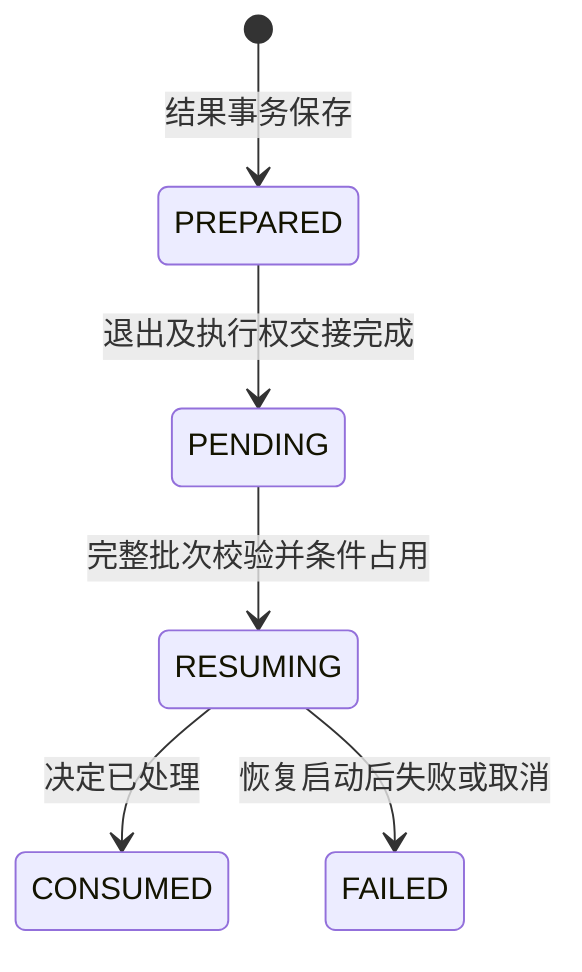

# Agent 如何编排，人工确认如何收口与恢复

[项目地图](index.md) · [会话交接](conversation.md) · [身份标识](data-and-identities.md) · [框架接入](framework-integration.md)

Trip 的 Pipeline 负责固定分析步骤，Master 按业务选择子 Agent。一次工具审批分段可包含多项决定，但客户端应提交完整批次。父子恢复坐标由框架保存，业务层负责可信票证、事务占用、正式消息与页面入口。

## 分析和委派分开



`AgentExecutePipeline` 用 `concatMap` 串行经过 Handler；上下文决定每一步实际执行还是跳过。恢复上下文直接指向 Master 执行步骤。规则命中结果会保存，供本轮与恢复读取；缓存与规则分支不等于额外执行了一次 LLM。

| Agent | 当前装配职责与工具范围 |
| --- | --- |
| 问题改写 / 意图识别 | 分析用户请求和多轮指代；不代替业务数据与执行结果 |
| Master | 委派、汇总；原生 Harness 外由一个 `AgentScopeHarnessAgent` 承接 Fons4AI 运行协议 |
| 行程管理 | 差旅单、审批查询与写操作、档案和关联预订记录 |
| 行程规划 | 搜索、候选读取、规划、审核、页面与所需政策/档案/天气 |
| 信息查询 | 政策、天气资讯、签证；天气 MCP 仅在客户端实际装配时加入 |

三个业务子 Agent 当前调用 `disableSubagents()`，不是无限递归 Agent 树。Master 的 Toolkit 明确设置 `parallel(false)`；默认委派策略还要求首次 task 非空并同步取得结果。框架的并发/批次能力不代表当前 Trip 已开启并行委派，图中不以并行执行作为前提。

## 三种人工与审核语义

| 名称 | 权威来源 | 含义 |
| --- | --- | --- |
| 工具执行许可 `APPROVAL` | SDK 权限规则、框架暂停信息、业务票证 | 是否批准、拒绝或编辑本批工具请求 |
| 补充信息 `INPUT_REQUIRED` | Agent 当前分段结果 | 需要补充字段或用户选择；当前结果正常结束，不创建工具审批票证 |
| 差旅审批 / 行程审核 | 差旅审批记录 / 方案审核服务 | 业务是否批准出差、方案是否可以推进，分别见业务专题 |

ASK 由 `trip.agent.master.approval-required-tools` 配置，并只应用到子 Agent 实际具有的工具。默认集合为空；提示词要求“先确认”不能作为所有工具已经配置 ASK 的证据。新增工具应同时检查工具集、权限规则和业务失败保护的覆盖。

## 为什么审批卡要等阶段结束



这是本地进程与共享状态的分段恢复路径，不要求将决定路由到原 JVM 中仍存活的子 Agent 对象。原生审批预检查发生在票证占用前；客户端决定动作，`hitlId`、原 Run 与其他恢复坐标来自服务端票证，不从客户端信任或重建。

### 票证生命周期



该图为主要成功/失败路径，不枚举未启动恢复的受控归还逻辑。已启动操作可能已有副作用，`FAILED` 不能自动改回可重试；再次 ASK 会形成新的批次，不能重用旧决定冒充新审批。

后端按 `pauseId`、`pauseVersion` 和完整消息 ID 集合校验决定，重复 ID、缺项和多项均拒绝。`EDIT` 必须带参数，非编辑动作不能附带非空参数。`requestId` 用于本次提交的识别；它不等于重复点击一定获得同一份 HTTP 成功响应。

简化恢复步骤：

```text
读取登录用户会话 -> 确认无活动执行
读取整批票证 -> 校验全部消息、版本与决定
从票证还原框架审批身份 -> 原生预检查
事务条件占用票证并保存恢复请求
创建新 Pipeline Run -> 实际订阅恢复
保存结果 -> 退出交接 -> 消费旧票证 / 开放新批次
```

## 源码入口与适用范围

- [Pipeline](../../fons4ai-trip-agent-service/src/main/java/com/fons/cloud/ai/trip/agent/pipeline/AgentExecutePipeline.java)、[上下文](../../fons4ai-trip-agent-service/src/main/java/com/fons/cloud/ai/trip/agent/pipeline/AgentPipelineExecuteContext.java)、[步骤目录](../../fons4ai-trip-agent-service/src/main/java/com/fons/cloud/ai/trip/agent/pipeline/support/)：分析分支与恢复直达。
- [MasterAgentConfig](../../fons4ai-trip-agent-service/src/main/java/com/fons/cloud/ai/trip/agent/core/MasterAgentConfig.java)、[委派策略](../../fons4ai-trip-agent-service/src/main/java/com/fons/cloud/ai/trip/infrastructure/agent/delegation/AgentScopeDelegationPolicy.java)：当前拓扑、工具、顺序与权限。
- [ConversationApplicationService](../../fons4ai-trip-agent-service/src/main/java/com/fons/cloud/ai/trip/application/conversation/ConversationApplicationService.java)：`prepareReplay`、`persistReplay`、`finalizeRunResult` 与失败释放路径。
- [ChatMessageHitl](../../fons4ai-trip-agent-service/src/main/java/com/fons/cloud/ai/trip/domain/entity/ChatMessageHitl.java)、[状态枚举](../../fons4ai-trip-agent-service/src/main/java/com/fons/cloud/ai/trip/common/constants/ChatMessageHitlStatus.java)、[审批卡](../../fons4ai-trip-agent-ui/src/components/ApprovalBatchCard.tsx)：可信票证、显示和提交。

本轮核对实现与调用关系，未重新执行双审批、混合决定、重复提交、多节点恢复或取消恢复的完整验收；不要由某一历史成功场景推断全部边界已通过。
