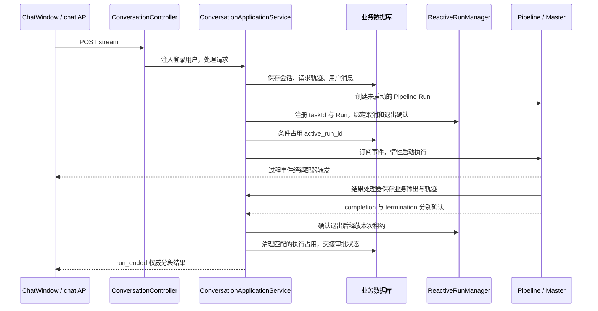
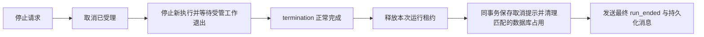

# 一次对话怎样执行、展示与结束

[项目地图](index.md) · [协作与 HITL](agents-and-hitl.md) · [数据与身份](data-and-identities.md)

会话 HTTP 接口负责可信用户入口，应用服务持久化请求并组织执行权，Pipeline 组合分析步骤和 Master，前端消费 SSE 并保存页面状态。业务聊天记录、SDK 会话和执行 Trace 分别承担不同职责。

## 正常请求的主要时序

图是正常执行的主路径，省略注册失败和恢复票证准备。实际流式序列由 `ChatStreamOutputAdapter` 组织；注册本身不订阅结果，避免比前端事件订阅更早启动任务。具体分析分支见 [Agent 编排](agents-and-hitl.md)。

`ConversationApplicationService.streamRun()` 独立订阅一个缓存的退出处理链：先等待 `termination()`，再读可回放的 `completion()`，完成状态、租约和业务占用交接。这个观察链不依赖 SSE 连接继续存在，避免断连后无人收尾。

## 页面以什么判断状态

| 信号 | 用途与边界 |
| --- | --- |
| `conversation_ready` | 返回可信业务会话和 Pipeline Run ID，供前端把临时会话对应到服务端 |
| 过程事件 | 展示思考、内容、任务过程等；内部 `type=hitl` 不直接开放正式审批 |
| `itinerary_page_ready` | 通知存在行程页面；页面读取仍需服务端重新校验归属与最新审核 |
| `run_ended` | 含 `pipelineRunId`、可用时的 `agentRunId`、`state`、`nextAction`、错误或人工交互信息；表示当前分段交接结果 |
| 执行查询接口 | 刷新/重新进入会话时读取服务端占用；不能仅用前端 fetch 是否结束判断空闲 |

审批卡来自已持久化并就绪的 `approvalMessages`；`approvalReady=true` 不由模型正文推断。`state=completed` 表示 Agent 当前分段结束，不代表业务审批通过、规划审核通过或已经完成预订。

取消结束时，`terminalMessages` 返回已入库的系统提示，沿用历史消息的 ID、创建时间和内容。前端按真实 ID 合并；`extra.runState` 与 `extra.pipelineRunId` 用于核对本次取消，不用旧记录覆盖后续请求的错误。

## 停止不是立刻释放

`POST /api/conversation/interrupt/{conversationId}` 从登录用户定位会话，再对当前 Pipeline Run 发起取消。前端应在停止收尾期间保持占用。`GET /{conversationId}/execution` 可能返回 `IDLE`、`RUNNING`、`STOPPING` 或 `UNKNOWN`；数据库仍记录执行而 Redis 不可确认时保留占用，不能自动清空或抢占。

当前服务的 SSE 取消路径会调用 `run.cancel()`；这意味着客户端断连可能影响执行，不能假定关页面后任务一定继续。原生调用是否已真实退出，仍由框架和 SDK 生命周期确认，见 [框架接入](framework-integration.md)。

## 标题、历史和删除

- 新会话在后端从首次有效文本生成标题：规范化空白，最多 24 个 Unicode 码点；无有效文本使用“新会话”。标题随 `ChatConversation` 一起入库，当前没有首次 LLM 自动命名机制。
- 历史正文从业务 `chat_message` 读取；分析与执行摘要按业务 `runId` 批量关联 `chat_request_trace`。SDK 的记忆、transcript 或中断回复不会自动变为前端聊天历史。
- 删除首先校验登录归属和空闲状态，事务内以 `active_run_id IS NULL` 条件删除会话并删除对应业务轨迹/消息。会话使用 MyBatis Plus 逻辑删除；不据此推断已清理全部 SDK、Redis、OSS 或 Langfuse 数据。

取消提示在实际退出后的收尾链保存：Pipeline 被取消而未产生结果，以及 Master 返回 `CANCELLED`，都进入 `finalizeCancelledRun()`，写入一条 `role=system`、内容为“本次执行已取消。”的业务消息。它与清理匹配的数据库占用同事务提交，保存失败时回滚占用清理，不能宣告取消已完成。收尾链由后台独立观察并缓存，SSE 断开不会放弃落库，事件发布和后台观察也不会各写一条。

这里保存的是取消状态提示；SDK 的内部中断文案和未完成的流式正文不会因此自动复制到业务历史。停止受理到实际退出之间仍保持 `STOPPING`；没有可靠来源时不区分“用户点击停止”与“连接断开触发取消”。普通失败、超时等分支的提示持久化仍是后续范围。

2026-10-18：后端生产编译、前端 TypeScript 检查与构建通过。重启后完成一条普通请求的最小手工验证：在问题改写阶段点击停止，页面先显示“正在停止”，随后显示取消提示；整页刷新后提示仍保留且只出现一次，输入框恢复可用。MySQL MCP 只读确认用户消息与系统取消消息属于同一业务 Run，且 `active_run_id` 已清空。会话为 `TRC1792335241603879d5d`，业务 Run 为 `TRT1792335241730879d5e`，Pipeline 为 `af7b8b91115341aba571bd3348cd5c93`。

本次未新增或执行单元测试，也未验证 Master 返回 `CANCELLED`、审批恢复中取消、断连后后台落库、保存失败回滚或多节点场景。截图和摘要保存在本地 `target/manual/cancellation-history-20261018/`，属于可清理的环境产物。旧会话缺失的取消记录不自动补写。

## 请求摘要与模型思考

当前工作树已接入两表读取与保存：正文及 Master 实际思考在 `chat_message`；问题改写、意图结果在 `chat_request_trace.analysis_content`；执行事实在 `execution_summary`，`used_tools` 只投影实际装配且已执行的业务工具名。框架内部工具仍保留在明细，待审批与业务防重短路不计作实际业务执行。

2026-10-20 的只读双任务已确认分析、Master 思考、父子模型用量及业务工具分类落库；模型阶段取消也保存了未知用量和一条刷新可读的取消提示。重启后已确认历史摘要解析、工具终态修复生效；双审批一次提交后，新 Run 单独统计新增查询与模型用量，并通过 originRunId 关联旧分段。刷新后两段摘要和已处理卡片保留。审批等待结果遗漏分段内容的修复也已通过新请求复验：两张审批消息仅第一张携带496字符 Master 思考，批次上方仅展示一次，刷新后与流式原文逐字一致。上述是核心路径的最小验收，未覆盖边界和具体 Run/截图集中见 [任务规划](../development/features/20261019-request-summary/任务规划.md)。

同 Run 的首条 TEXT Agent/AgentHitl 消息承载一份 Master 思考，`extra.thinkingAgentName` 明确来源；审批批次上方只展示一次。分析过程提示和刷新后的分析结果来自各自入口，不混成模型思考。取消仍保存既有状态提示和已知请求摘要，本阶段不补存未完成的模型正文/思考。

`used_token` 是本 Run 可取得的输入与输出 Token 小计，缓存输入不重复相加；完整性以 JSON 中的 `usageComplete` 判断。SDK 原生压缩/记忆维护可能绕过模型事件，相应节点存在这些中间件时保守标为不完整。未知不能解释为零，关闭观测不改变摘要链路。详细规则与验收范围见 [本次设计](../development/features/20261019-request-summary/技术设计.md)。

## 接口与源码阅读入口

API 基路径为 `/api/conversation`：`POST /stream`、`POST /replay`、`POST /interrupt/{conversationId}`、`GET /{conversationId}/execution`、`GET /list`、`GET /{conversationId}/messages`、`DELETE /{conversationId}`。请求与返回以当前 DTO 和 Controller 为准，审批细节在下一专题维护。

1. [ConversationController](../../fons4ai-trip-agent-service/src/main/java/com/fons/cloud/ai/trip/controller/ConversationController.java)：鉴权身份和接口。
2. [ConversationApplicationService](../../fons4ai-trip-agent-service/src/main/java/com/fons/cloud/ai/trip/application/conversation/ConversationApplicationService.java)：`streamRun`、`handleChatResult`、`finalizeRunResult`、`interrupt`、`delete`。
3. [ChatStreamOutputAdapter](../../fons4ai-trip-agent-service/src/main/java/com/fons/cloud/ai/trip/application/conversation/ChatStreamOutputAdapter.java)：事件过滤、执行权交接与权威终态。
4. [ChatConversation](../../fons4ai-trip-agent-service/src/main/java/com/fons/cloud/ai/trip/domain/entity/ChatConversation.java)、[会话领域服务](../../fons4ai-trip-agent-service/src/main/java/com/fons/cloud/ai/trip/domain/service/impl/ChatConversationDomainServiceImpl.java)：标题、逻辑删除和条件更新。
5. [前端 chat API](../../fons4ai-trip-agent-ui/src/api/chat.ts)、[ChatWindow](../../fons4ai-trip-agent-ui/src/components/ChatWindow.tsx)、[chatStore](../../fons4ai-trip-agent-ui/src/store/chatStore.ts)：SSE 解析与页面状态。

已有对话和 SSE 测试可从 [测试目录](../../fons4ai-trip-agent-service/src/test/java/com/fons/cloud/ai/trip/application/conversation/) 阅读。本轮未执行这些测试；取消提示的手工验证范围见上文。
