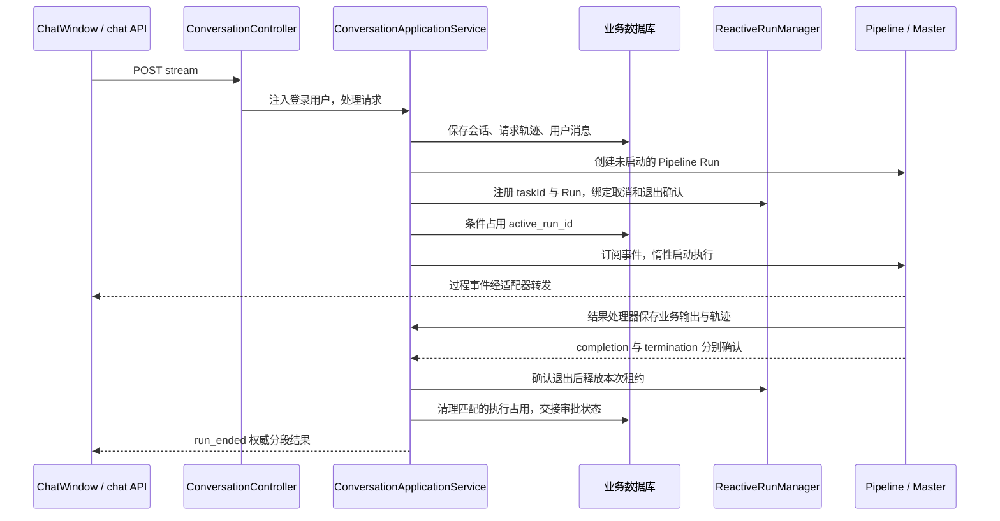
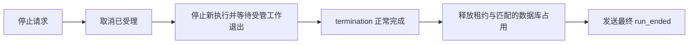

# 一次对话怎样执行、展示与结束

[项目地图](index.md) · [协作与 HITL](agents-and-hitl.md) · [数据与身份](data-and-identities.md)

会话 HTTP 接口负责可信用户入口，应用服务持久化请求并组织执行权，Pipeline 组合分析步骤和 Master，前端消费 SSE 并保存页面状态。业务聊天记录、SDK 会话和执行 Trace 分别承担不同职责。

## 正常请求的主要时序

图是正常执行的主路径，省略注册失败和恢复票证准备。实际流式序列由 `ChatStreamOutputAdapter` 组织；注册本身不订阅结果，避免比前端事件订阅更早启动任务。具体分析分支见 [Agent 编排](agents-and-hitl.md)。

`ConversationApplicationService.streamRun()` 独立订阅一个缓存的退出处理链：先等待 `termination()`，再读可回放的 `completion()`，完成状态、租约和业务占用交接。这个观察链不依赖 SSE 连接继续存在，避免断连后无人收尾。

## 页面以什么判断状态

| 信号 | 用途与边界 |
| --- | --- |
| `conversation_ready` | 返回可信业务会话和 Pipeline Run ID，供前端把临时会话对应到服务端 |
| 过程事件 | 展示思考、内容、任务过程等；内部 `type=hitl` 不直接开放正式审批 |
| `itinerary_page_ready` | 通知存在行程页面；页面读取仍需服务端重新校验归属与最新审核 |
| `run_ended` | 含 `pipelineRunId`、可用时的 `agentRunId`、`state`、`nextAction`、错误或人工交互信息；表示当前分段交接结果 |
| 执行查询接口 | 刷新/重新进入会话时读取服务端占用；不能仅用前端 fetch 是否结束判断空闲 |

审批卡来自已持久化并就绪的 `approvalMessages`；`approvalReady=true` 不由模型正文推断。`state=completed` 表示 Agent 当前分段结束，不代表业务审批通过、规划审核通过或已经完成预订。

## 停止不是立刻释放

`POST /api/conversation/interrupt/{conversationId}` 从登录用户定位会话，再对当前 Pipeline Run 发起取消。前端应在停止收尾期间保持占用。`GET /{conversationId}/execution` 可能返回 `IDLE`、`RUNNING`、`STOPPING` 或 `UNKNOWN`；数据库仍记录执行而 Redis 不可确认时保留占用，不能自动清空或抢占。

当前服务的 SSE 取消路径会调用 `run.cancel()`；这意味着客户端断连可能影响执行，不能假定关页面后任务一定继续。原生调用是否已真实退出，仍由框架和 SDK 生命周期确认，见 [框架接入](framework-integration.md)。

## 标题、历史和删除

- 新会话在后端从首次有效文本生成标题：规范化空白，最多 24 个 Unicode 码点；无有效文本使用“新会话”。标题随 `ChatConversation` 一起入库，当前没有首次 LLM 自动命名机制。
- 历史从业务 `chat_message` 读取；SDK 的记忆、transcript 或中断回复不会自动变为前端聊天历史。
- 删除首先校验登录归属和空闲状态，事务内以 `active_run_id IS NULL` 条件删除会话并删除对应业务轨迹/消息。会话使用 MyBatis Plus 逻辑删除；不据此推断已清理全部 SDK、Redis、OSS 或 Langfuse 数据。

**当前缺口：**取消、超时和失败等分支可能更新业务轨迹却不保存一条可展示的业务终态消息。`handleChatResult()` 对 `CANCELLED` 等结果返回空消息列表，前端 `runError` 是内存状态，因此刷新后可能只剩用户消息。这是待修复行为，不能将“SDK 已保存中断回复”视为问题已解决。

## 接口与源码阅读入口

API 基路径为 `/api/conversation`：`POST /stream`、`POST /replay`、`POST /interrupt/{conversationId}`、`GET /{conversationId}/execution`、`GET /list`、`GET /{conversationId}/messages`、`DELETE /{conversationId}`。请求与返回以当前 DTO 和 Controller 为准，审批细节在下一专题维护。

1. [ConversationController](../../fons4ai-trip-agent-service/src/main/java/com/fons/cloud/ai/trip/controller/ConversationController.java)：鉴权身份和接口。
2. [ConversationApplicationService](../../fons4ai-trip-agent-service/src/main/java/com/fons/cloud/ai/trip/application/conversation/ConversationApplicationService.java)：`streamRun`、`handleChatResult`、`finalizeRunResult`、`interrupt`、`delete`。
3. [ChatStreamOutputAdapter](../../fons4ai-trip-agent-service/src/main/java/com/fons/cloud/ai/trip/application/conversation/ChatStreamOutputAdapter.java)：事件过滤、执行权交接与权威终态。
4. [ChatConversation](../../fons4ai-trip-agent-service/src/main/java/com/fons/cloud/ai/trip/domain/entity/ChatConversation.java)、[会话领域服务](../../fons4ai-trip-agent-service/src/main/java/com/fons/cloud/ai/trip/domain/service/impl/ChatConversationDomainServiceImpl.java)：标题、逻辑删除和条件更新。
5. [前端 chat API](../../fons4ai-trip-agent-ui/src/api/chat.ts)、[ChatWindow](../../fons4ai-trip-agent-ui/src/components/ChatWindow.tsx)、[chatStore](../../fons4ai-trip-agent-ui/src/store/chatStore.ts)：SSE 解析与页面状态。

已有对话和 SSE 测试可从 [测试目录](../../fons4ai-trip-agent-service/src/test/java/com/fons/cloud/ai/trip/application/conversation/) 阅读。本轮未执行这些测试或重新验证页面。
