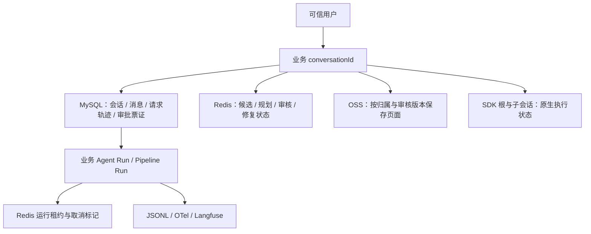

# 数据保存在哪里，身份怎样关联

[项目地图](index.md) · [对话](conversation.md) · [审批](agents-and-hitl.md) · [规划](itinerary-planning.md)

排查数据错位时先确认“用户、根业务会话、物理执行和原生 SDK 会话”是哪一个维度。候选、规划与页面使用根业务会话，SDK 子会话用于原生状态恢复；它们不互相替代。

## 数据权威分工

这是代码中的归属与关联示意，不是实际数据库外键或基数图，也不表示这些存储共享一个事务。数据库消息支持业务历史，SDK 状态支持原生续跑，Trace 解释发生过什么，三者用途不同。

| 数据 | 当前保存入口 | 不能据此推断的内容 |
| --- | --- | --- |
| 会话、消息、请求记录 | MySQL：`chat_conversation`、`chat_message`、`chat_request_trace` | Trace 结束不自动生成用户可见的状态消息 |
| 工具审批票证 | MySQL：`chat_message_hitl`，按消息保存扩展信息，并关联会话/批次 | 业务票证不是 SDK 父子 checkpoint 的全部副本 |
| 差旅单、审批、档案、政策、预订记录 | MySQL 领域实体与 Mapper | 有预订记录表不代表支持真实下单、支付与退款 |
| 搜索候选 | `ItineraryCandidateRepository` 的 Redis Hash，按可信用户、根会话、行程分组 | 同会话不同路线/日期不能混成一池；当前页返回不代表累计池 |
| 规划、审核、修复循环 | 对应 Redis Repository；规划仓储当前不设置 TTL | 长期无 TTL 不代表已经设计好了归档和删除策略 |
| 行程 HTML | `ItineraryPlanPageStore` 的 OSS 对象 | 外部对象路径不作为客户端任意读取授权 |
| SDK 会话与 Harness 存储 | Fons4AI 共享状态/分布式存储适配；随实际 provider 装配 | 本轮未核实实际库中所有 SDK 表结构与部署迁移 |
| 可观测性 | JSONL、OTel 和 Langfuse | 观测关闭不得改变业务归属，Trace 不作为审批权威 |

## 标识对照

| 标识 | 用在什么地方 | 来源与注意点 |
| --- | --- | --- |
| `userId` | 身份、归属与隔离 | Controller 登录态 / 可信执行上下文；不由模型选择 |
| `conversationId` | 业务会话、候选、规划、审核与页面 | 根业务会话；`TripRuntimeContext` 读取框架固化属性，不回退到 SDK 子会话 |
| 业务 `runId` / `agentRunId` | 请求轨迹、Agent 运行、分析结果及审批关联 | 普通请求由 `ChatRequestTrace` 创建；Pipeline 在缺失时补齐 Agent 请求身份 |
| `pipelineRunId` | 外层普通响应式运行与 `active_run_id` | 由 common-reactor 工厂创建，与业务 Agent Run 分开 |
| `taskId` | Redis 租约的互斥范围 | Pipeline 为 `TRIP-WORKER:<conversationId>`；公共 Agent 适配为 `agent:<conversationId>` |
| SDK `sessionId` | 原生父子会话状态与续跑坐标 | 原生子节点可有独立 session；不是业务候选归属 |
| `pauseId` / `pauseVersion` | 一次暂停批次及保存版本 | 同批多条审批共用，不能只根据卡片数量或文本分组 |
| `hitlId` / `resumeRef` | 工具许可与恢复关联 | 保存在服务端票证中，恢复时使用可信值 |
| 恢复 `requestId` | 一次整批决定提交 | 识别与审计提交；不等于 Agent Run 或 Trace ID |
| `planId` / `reviewId` / `proposalId` | 规划、审核和推荐方案引用 | 来自真实保存结果；发布时三者对应关系重新校验 |
| OTel `traceId` / `spanId` | 查观测树与具体节点 | 不是运行占用凭证；业务 Run 与 Pipeline Run 通过属性关联 |

在工具中构造 `CandidateOwner` 时使用可信用户和 `TripRuntimeContext.conversationId(context)`。若根业务身份缺失，应该沿已有校验失败，不以当前 SDK `sessionId` 或 Langfuse session 临时补齐。

## 条件更新与数据清理

`active_run_id` 保存 Pipeline Run ID。占用只允许原值为空，释放只允许原值仍匹配当前 Run；删除会话也使用空闲条件。Redis 缺失或不可读时，数据库占用不能被直接清掉。

业务聊天删除与 SDK 状态、候选 Redis、OSS、Trace 的清理没有天然等价关系。新增清理能力应先确定用户可见删除、恢复需求与实际资源所有者，不能假定一条业务 `DELETE` 会级联清除全部外部数据。

## 结构与核查入口

- [ChatConversation](../../fons4ai-trip-agent-service/src/main/java/com/fons/cloud/ai/trip/domain/entity/ChatConversation.java)、[ChatRequestTrace](../../fons4ai-trip-agent-service/src/main/java/com/fons/cloud/ai/trip/domain/entity/ChatRequestTrace.java)、[ChatMessageHitl](../../fons4ai-trip-agent-service/src/main/java/com/fons/cloud/ai/trip/domain/entity/ChatMessageHitl.java)：业务关联字段。
- [TripRuntimeContext](../../fons4ai-trip-agent-service/src/main/java/com/fons/cloud/ai/trip/infrastructure/agent/TripRuntimeContext.java)、[候选仓储](../../fons4ai-trip-agent-service/src/main/java/com/fons/cloud/ai/trip/infrastructure/repository/ItineraryCandidateRepository.java)、[规划仓储](../../fons4ai-trip-agent-service/src/main/java/com/fons/cloud/ai/trip/infrastructure/repository/ItineraryPlanRepository.java)：可信归属和保存。
- [页面存储](../../fons4ai-trip-agent-service/src/main/java/com/fons/cloud/ai/trip/infrastructure/repository/ItineraryPlanPageStore.java)、[会话领域服务](../../fons4ai-trip-agent-service/src/main/java/com/fons/cloud/ai/trip/domain/service/impl/ChatConversationDomainServiceImpl.java)：对象边界与条件更新。
- [schema.sql](../../fons4ai-trip-agent-service/src/main/resources/db/schema.sql)、[批次迁移](../../fons4ai-trip-agent-service/src/main/resources/db/migration/20261014-batch-hitl.sql)、[恢复迁移](../../fons4ai-trip-agent-service/src/main/resources/db/migration/20261014-batch-hitl-replay.sql)：仓库 DDL 定义。本轮没有查询数据库或确认这些迁移已安装。

历史联调曾发现候选保存到 SDK 子会话的问题，当前源码已通过根身份适配修正相关读取路径；后续修改搜索、恢复或页面时仍要回查这些入口，不因已有修复而省略归属检查。
