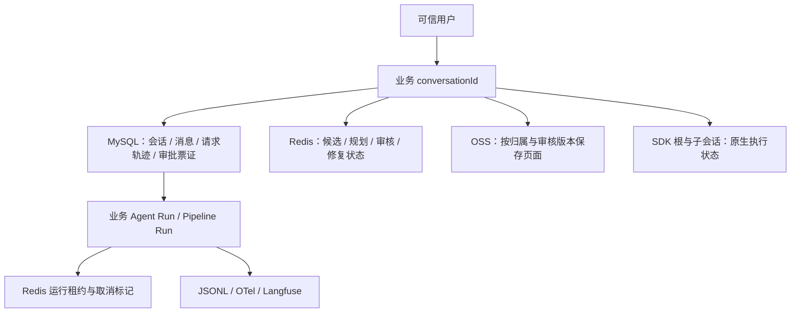

# 数据保存在哪里，身份怎样关联

[项目地图](index.md) · [对话](conversation.md) · [审批](agents-and-hitl.md) · [规划](itinerary-planning.md)

排查数据错位时先确认“用户、差旅单、根业务会话、物理执行和原生 SDK 会话”是哪一个维度。当前工作树中候选按用户与差旅单及行程条件归属；运行期规划和审核还按根业务会话隔离，SDK 子会话用于原生状态恢复。T-2 改造尚待实际联调验证。

## 数据权威分工

这是代码中的归属与关联示意，不是实际数据库外键或基数图，也不表示这些存储共享一个事务。业务消息与请求摘要支持会话历史，SDK 状态支持原生续跑，OTel/Langfuse 解释执行链路，三者用途不同。这里的 `chat_request_trace` 是业务表，不是观测平台 Trace 的存储副本。

| 数据 | 当前保存入口 | 不能据此推断的内容 |
| --- | --- | --- |
| 会话、消息、请求记录 | MySQL：`chat_conversation`、`chat_message`、`chat_request_trace` | Trace 结束不自动生成用户可见的状态消息 |
| 工具审批票证 | MySQL：`chat_message_hitl`，按消息保存扩展信息，并关联会话/批次 | 业务票证不是 SDK 父子 checkpoint 的全部副本 |
| 差旅单、审批、档案、政策、预订记录 | MySQL 领域实体与 Mapper | 有预订记录表不代表支持真实下单、支付与退款 |
| 搜索候选 | `ItineraryCandidateRepository` 的 Redis MapCache，按可信用户、差旅单和行程条件分组 | 每条最多保留 30 分钟；当前页返回不代表累计池，真实过期行为尚待联调 |
| 规划、审核、修复循环 | 对应 Redis Repository；规划仓储当前不设置 TTL | 长期无 TTL 不代表已经设计好了归档和删除策略 |
| 最新已发布行程方案 | `travel_order_itinerary_plan`：每单保存规划和审核快照、页面对象标识 | 工作树已实现发布及读取，尚未联调；不是预订记录或历史方案表 |
| 行程 HTML | `ItineraryPlanPageStore` 的 OSS 对象 | 外部对象路径不作为客户端任意读取授权 |
| SDK 会话与 Harness 存储 | Fons4AI 共享状态/分布式存储适配；随实际 provider 装配 | 本轮未核实实际库中所有 SDK 表结构与部署迁移 |
| 可观测性 | JSONL、OTel 和 Langfuse | 观测关闭不得改变业务归属，Trace 不作为审批权威 |

## 用户档案的偏好列

2026-10-26 用户手动执行偏好迁移，MySQL MCP 只读核验 trip.user_profile 中 travel_preferences 为可空 JSON，preference_version 为非空 BIGINT、默认 0。R2.3 沿用这两列：业务数据为统一 key/value/status/updatedAt 对象组成的 JSON List，不含 schemaVersion 或逐项 version；独立版本列保护整份列表。旧 confirmedAt/source/sourceRef/evidence 仅兼容读取时忽略，新保存不再写入。空字段/空列表表示未设置，已清除项保留 CLEARED；本轮不做批量数据清理或新增 DDL。

普通档案 Mapper 默认不选择、插入或更新偏好列，避免城市、联系人等普通读写受额外 JSON 映射影响。偏好功能依赖现有两列，迁移完成后随应用正常接入，不设单独开关。偏好专用查询通过 TypeHandler 映射列表；保存用 user_id 与 expectedVersion 条件一次写入，禁止旧整份快照无条件覆盖。MCP 当前只证明列结构，尚未验证真实业务写入；[业务语义与入口](travel-business.md#结构化差旅偏好与原生记忆) 不在本页重复维护。

## 标识对照

| 标识 | 用在什么地方 | 来源与注意点 |
| --- | --- | --- |
| `userId` | 身份、归属与隔离 | Controller 登录态 / 可信执行上下文；不由模型选择 |
| `conversationId` | 业务会话、运行期规划、审核与页面 | 根业务会话；`TripRuntimeContext` 读取框架固化属性，不回退到 SDK 子会话 |
| `orderId` | 差旅单与订单候选的业务归属 | 模型提供单号后，服务端按可信用户校验归属与当前行程条件 |
| 业务 `runId` / `agentRunId` | 请求轨迹、Agent 运行、分析结果及审批关联 | 普通请求由 `ChatRequestTrace` 创建；Pipeline 在缺失时补齐 Agent 请求身份 |
| `pipelineRunId` | 外层普通响应式运行与 `active_run_id` | 由 common-reactor 工厂创建，与业务 Agent Run 分开 |
| `taskId` | Redis 租约的互斥范围 | Pipeline 为 `TRIP-WORKER:<conversationId>`；公共 Agent 适配为 `agent:<conversationId>` |
| SDK `sessionId` | 原生父子会话状态与续跑坐标 | 原生子节点可有独立 session；不是业务候选归属 |
| `pauseId` / `pauseVersion` | 一次暂停批次及保存版本 | 同批多条审批共用，不能只根据卡片数量或文本分组 |
| `hitlId` / `resumeRef` | 工具许可与恢复关联 | 保存在服务端票证中，恢复时使用可信值 |
| 恢复 `requestId` | 一次整批决定提交 | 识别与审计提交；不等于 Agent Run 或 Trace ID |
| `planId` / `reviewId` / `proposalId` | 规划、审核和推荐方案引用 | 来自真实保存结果；发布时三者对应关系重新校验 |
| OTel `traceId` / `spanId` | 查观测树与具体节点 | 不是运行占用凭证；业务 Run 与 Pipeline Run 通过属性关联 |

工具直接使用可信用户、差旅单标识和必要的根业务会话标识，不再构造 `CandidateOwner`。若根业务身份缺失，应该沿已有校验失败，不以当前 SDK `sessionId` 或 Langfuse session 临时补齐。

## 消息与请求摘要字段

下表描述当前代码与本次迁移的职责；JSON 内的关联字段不是数据库外键，完整处理顺序见 [会话保存与历史读取](conversation.md#两表保存与历史读取)。

| 保存位置 | 保存内容与口径 |
| --- | --- |
| `chat_message.content` / `thinking` | 用户可见正文与本段实际 Master 思考；同 Run 的思考只使用一个消息载体，没有真实思考时不补造 |
| `chat_message.extra.thinkingAgentName` | 思考来源身份；审批卡 `agent_name` 可以指向子 Agent，不能因此将 Master 思考归到子节点 |
| `chat_message.extra.interactionKind` | `INPUT_REQUIRED` 的可信类型标记，供最后一条消息的待补充状态还原；用户通过底部聊天框回答，其他业务数据仍保留在同一 extra，不新增审批票证或数据库列 |
| `chat_request_trace.analysis_content` | 改写结果、意图识别结果；应用的分析过程提示不作为模型思考保存 |
| `chat_request_trace.used_tools` | 实际装配且真正执行的业务工具名称，按名称去重；待审批、拒绝及业务防重短路不算再次执行；内部委派/文件工具只保留在执行明细 |
| `chat_request_trace.used_token` | 本分段可取得的模型输入与输出 Token 小计，缓存输入不再次累加；未知为 NULL，不能用零代替缺失 |
| `execution_summary.modelCalls` / `toolCalls` | 按调用尝试保存身份、节点、用量或状态、执行标志与已知来源；不保存完整参数或供应商响应 |
| `execution_summary.usageComplete` | 已知小计是否足以表示完整消耗；原生维护模型可能绕过事件时保守为 false，不把小计当总账 |
| `execution_summary.originRunId` | 恢复 Run 对原业务 Run 的关联；恢复不修改旧分段用量，也不复制旧模型调用 |

`execution_summary` 当前版本为 1。缺少或无法解析的历史摘要按未知处理，旧 `used_tools` 只作为历史工具记录展示；不将旧 `agent_spawn` 重新解释成业务工具。提供方来源只记录实际业务结果中有证据的标识，缺失时为空，不等于请求未发出或供应商调用次数为零。

## 条件更新与数据清理

请求级摘要以 `chat_request_trace.run_id` 归属，不随审批恢复累计旧分段：恢复创建新 Run，用 `execution_summary.originRunId` 关联原请求。`execution_summary` 可空 JSON 列已由用户手动迁移并通过 MCP 核验；旧记录不回填。历史 API 先校验会话归属，再按本页 Run 批量关联，损坏/未知版本摘要按未知处理。当前工作树实现与尚待验收项见 [任务规划](../development/features/20261019-request-summary/任务规划.md)。

`active_run_id` 保存 Pipeline Run ID。占用只允许原值为空，释放只允许原值仍匹配当前 Run；删除会话也使用空闲条件。Redis 缺失或不可读时，数据库占用不能被直接清掉。

业务聊天删除与 SDK 状态、候选 Redis、OSS、Trace 的清理没有天然等价关系。新增清理能力应先确定用户可见删除、恢复需求与实际资源所有者，不能假定一条业务 `DELETE` 会级联清除全部外部数据。

## 结构与核查入口

- [ChatConversation](../../fons4ai-trip-agent-service/src/main/java/com/fons/cloud/ai/trip/domain/entity/ChatConversation.java)、[ChatRequestTrace](../../fons4ai-trip-agent-service/src/main/java/com/fons/cloud/ai/trip/domain/entity/ChatRequestTrace.java)、[ChatMessageHitl](../../fons4ai-trip-agent-service/src/main/java/com/fons/cloud/ai/trip/domain/entity/ChatMessageHitl.java)：业务关联字段。
- [TripRuntimeContext](../../fons4ai-trip-agent-service/src/main/java/com/fons/cloud/ai/trip/infrastructure/agent/TripRuntimeContext.java)、[候选仓储](../../fons4ai-trip-agent-service/src/main/java/com/fons/cloud/ai/trip/infrastructure/repository/ItineraryCandidateRepository.java)、[规划仓储](../../fons4ai-trip-agent-service/src/main/java/com/fons/cloud/ai/trip/infrastructure/repository/ItineraryPlanRepository.java)：可信归属和保存。
- [页面存储](../../fons4ai-trip-agent-service/src/main/java/com/fons/cloud/ai/trip/infrastructure/repository/ItineraryPlanPageStore.java)、[会话领域服务](../../fons4ai-trip-agent-service/src/main/java/com/fons/cloud/ai/trip/domain/service/impl/ChatConversationDomainServiceImpl.java)：对象边界与条件更新。
- [schema.sql](../../fons4ai-trip-agent-service/src/main/resources/db/schema.sql)、[批次迁移](../../fons4ai-trip-agent-service/src/main/resources/db/migration/20261014-batch-hitl.sql)、[恢复迁移](../../fons4ai-trip-agent-service/src/main/resources/db/migration/20261014-batch-hitl-replay.sql)：仓库 DDL 定义，不据此认定测试库全部迁移均已核验。
- [请求摘要迁移](../../fons4ai-trip-agent-service/src/main/resources/db/migration/20261019_request_execution_summary.sql)：用户已手动执行，2026-10-19/20 MySQL MCP 只读确认新增列为可空 JSON；此结论仅覆盖该列，不扩大为全部 SDK/业务表结构一致。知识维护不再次执行 DDL。
- [ChatMessageAggregate](../../fons4ai-trip-agent-service/src/main/java/com/fons/cloud/ai/trip/domain/entity/ChatMessageAggregate.java)、[RequestTraceInfo](../../fons4ai-trip-agent-service/src/main/java/com/fons/cloud/ai/trip/common/vo/RequestTraceInfo.java)：业务字段投影、版本与历史 JSON 容错。

历史联调曾发现候选保存到 SDK 子会话的问题，当前源码已通过根身份适配修正相关读取路径；后续修改搜索、恢复或页面时仍要回查这些入口，不因已有修复而省略归属检查。
