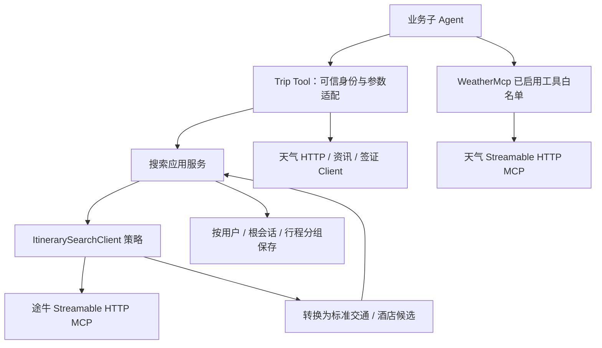

# 外部信息与供应商工具怎样接入

[项目地图](index.md) · [候选与规划](itinerary-planning.md) · [数据身份](data-and-identities.md) · [工程约定](工程约定.md)

Trip 有两种主要接入方式：业务工具委托应用服务/Client，将供应商结果转换为标准业务数据；天气 MCP 则由 SDK 客户端发现工具并按配置白名单装配。工具类存在、MCP 初始化成功、查询成功和业务结果可用分别需要依据。

## 当前接入路径

图只描述已定位的装配与调用职责，不表示每次请求会调用全部供应商。候选先保存到业务仓储，再供规划引用；不能把供应商大段原始结果直接当作可信规划输入。

| 能力 | 当前入口 | 关键契约 |
| --- | --- | --- |
| 当前天气与短期预报 | `DestinationLiveTools` → `WeatherClient` | 工具声明支持今天及未来两天；以实际返回日期和城市校验，不代替远期预报 |
| 更长周期天气 | `WeatherMcp` | Streamable HTTP + Bearer 认证，发现后只装配启用列表；目标日期必须被实际响应覆盖 |
| 火车票、机票 | `ItinerarySearchTools` → 搜索应用服务 → `TuniuSearchClient` | 单程、分页、席别/舱位、时区、金额和库存分别保留 |
| 酒店与房型 | 同上，先酒店列表再具体房型 | 列表起价、具体报价和完整住宿总价不同；人数、儿童年龄、间夜条件保持一致 |
| 目的地资讯 | `DestinationNewsClient` | 保留来源、发布时间及查询条件；空结果和外部失败分开 |
| 签证 | `OriznVisaClient` / `VisaTools` | 按护照签发国、目的地国家及返回适用条件解释，不把信息查询等同于担保结论 |

## MCP 发现与业务装配

`WeatherMcp` 使用 AgentScope 的 MCP 客户端包装，读取 `trip.mcp.weather`。`MasterAgentConfig` 仅在客户端非空时向规划/信息 Agent 注册启用工具。端点、认证和工具名都必须匹配实际服务，不能把“工具列表能返回”当作调用已成功。

途牛 Client 使用 MCP Java 客户端，经 `apiKey` 请求头发送企业服务凭据，配置来源为 `trip.mcp.tuniu`。当前路径不从员工个人 `user_api_key` 读取途牛搜索凭据；`ApiKeyTools` 的存在不代表它已装配到这些 Agent。不要把密钥交给模型或保存进候选。

当前主模型适配与供应商 MCP 客户端是不同协议边界；调整模型 API Base 不会自动修复 MCP 的认证或 Endpoint。

## 响应、分页与报价

`TuniuSearchClient` 优先读取 MCP `structuredContent`，兼容文本块中的明确业务 JSON。针对单字段 `{"result": ...}` 包装只解开一层，再按原业务状态、数据数组与条目结构校验；不递归剥离任意包装，也不忽略业务失败标记。

标准候选区分班次和报价：同车次不同席别可以是不同候选。分页沿用原查询条件及继续查询凭据；返回的当前页与仓储累计候选池不是同一集合。换路线、日期或入住条件时重新确认归属，避免旧分页参数串查询。

报价以 `SearchPriceBasis` 显式区分单人单程、单间每晚、单间全程和 `UNKNOWN`。当前酒店供应商响应缺少足够依据时保留原始金额并标记 `UNKNOWN`，不根据住几晚、取消费用或历史样本反推总价。规划服务会排除不满足客观计算条件的候选，具体在规划专题维护。

## 失败与重复调用边界

| 情况 | 应保留的含义 |
| --- | --- |
| 成功但无候选 | 真实空结果；不虚构班次或酒店 |
| 参数或日期范围不支持 | 说明具体限制，调整条件或请求补充 |
| 鉴权、超时、响应解析失败 | 外部/系统失败，不改写为“没有票” |
| 报价缺少单位或计价口径 | 保留不确定性，不能进入确定总价计算 |
| 可选天气资讯失败 | 不应抹去已经获得的核心交通住宿结果；实际是否阻塞还需核对工具与审核策略 |

业务工具保护中间件、SDK 单次调用重试与模型下一轮再次调用是不同机制。`toolFailureLimit` 默认限制同一次子 Agent 调用中同一业务工具的系统失败次数，非阻塞可选工具另行配置；它不是给所有 MCP/文件工具统一增加可靠性保证。

提示词对日期选择、禁止编造、失败后不重复和确认操作有指导作用；只有代码、SDK 权限或实际服务执行的约束才可表述为强制保证。

## 新增或调整工具的阅读路线

先定位业务 Agent 的实际 Toolkit，再检查 `BaseTool.tools()` 名单、失败保护和可选 ASK 规则；供应商参数/返回由 Client 转换，业务应用服务保存可信候选，最后核对页面与规划能否消费。

本轮未调用供应商。历史天气、交通住宿只读查询有局部联调材料，候选根会话与酒店未知价格口径曾重点核对；这些不能作为当前全部日期、分页、供应商故障或规划闭环已通过的证明。

## 依据与入口

- [WeatherMcp](../../fons4ai-trip-agent-service/src/main/java/com/fons/cloud/ai/trip/agent/mcp/WeatherMcp.java)、[MCP 属性](../../fons4ai-trip-agent-service/src/main/java/com/fons/cloud/ai/trip/infrastructure/config/properties/TripMcpConfigProperties.java)、[Master 装配](../../fons4ai-trip-agent-service/src/main/java/com/fons/cloud/ai/trip/agent/core/MasterAgentConfig.java)。
- [搜索工具](../../fons4ai-trip-agent-service/src/main/java/com/fons/cloud/ai/trip/agent/tool/ItinerarySearchTools.java)、[搜索服务](../../fons4ai-trip-agent-service/src/main/java/com/fons/cloud/ai/trip/application/itinerary/ItinerarySearchApplicationService.java)、[客户端接口](../../fons4ai-trip-agent-service/src/main/java/com/fons/cloud/ai/trip/infrastructure/client/api/ItinerarySearchClient.java)。
- [TuniuSearchClient](../../fons4ai-trip-agent-service/src/main/java/com/fons/cloud/ai/trip/infrastructure/client/TuniuSearchClient.java)、[供应商转换](../../fons4ai-trip-agent-service/src/main/java/com/fons/cloud/ai/trip/infrastructure/client/model/tuniu/TuniuSearchConverter.java)、[计价口径](../../fons4ai-trip-agent-service/src/main/java/com/fons/cloud/ai/trip/common/constants/SearchPriceBasis.java)。
- [天气/资讯工具](../../fons4ai-trip-agent-service/src/main/java/com/fons/cloud/ai/trip/agent/tool/DestinationLiveTools.java)、[签证工具](../../fons4ai-trip-agent-service/src/main/java/com/fons/cloud/ai/trip/agent/tool/VisaTools.java)、[业务工具保护](../../fons4ai-trip-agent-service/src/main/java/com/fons/cloud/ai/trip/infrastructure/middleware/TripToolExecutionGuardMiddleware.java)。
