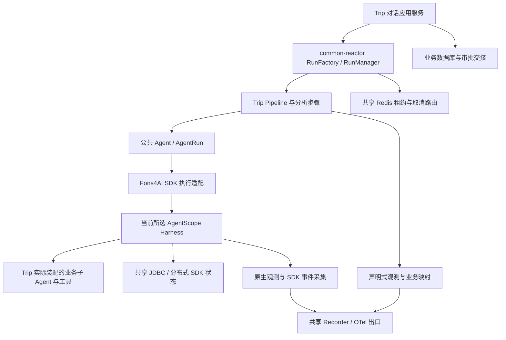

# Trip 如何接入框架，运行问题从哪里排查

[项目地图](index.md) · [会话生命周期](conversation.md) · [审批业务交接](agents-and-hitl.md) · [身份关联](data-and-identities.md)

Fons4AI 提供公共 Agent 协议、响应式运行、SDK 适配与观测；Trip 决定分析流程、业务 Agent、工具、事务与客户端交互。这里记录 Trip 的实际接入，框架通用机制在框架仓库单处解释。

## 当前依赖与装配边界

服务 POM 声明父工程 Fons4AI `1.0.0`，直接使用 `fons4ai-agentscope-starter`，并引入 DashScope/OpenAI 模型扩展与 Fons4Cloud 缓存、数据库、文件及认证组件。当前父工程声明 Java 21、Spring Boot 3.5.8、AgentScope 2.0.3；声明依赖不表示当前运行实例已加载某份本地修补产物。

图描述 Trip 当前选择 AgentScope 的实现。公共运行与观测契约本身不限定 SDK；更换框架需要重新核对实际适配与恢复能力，不能只替换依赖名。

`MasterAgentConfig` 用一个 `AgentScopeHarnessAgent` 包装 Master；三个业务子 Agent 是原生 HarnessAgent，分别配置 Toolkit。共用模型选择、时间上下文、原生 OTel/Fons 观测、活动 Agent 保存、共享存储和工作空间。子 Agent 另外装配执行生命周期与审批拒绝处理中间件，确保它们进入同一取消/恢复边界。

## 运行与 SDK 状态如何衔接

Pipeline 通过 `scope.relay(masterRun)` 接入 Master 的事件、权威结果、取消与退出确认。`ReactiveRunManager` 管理租约和取消句柄；SDK 内部节点与已准入工具是否退出，由执行适配汇总，不能以 `completion()` 或 SSE 结束释放业务执行权。

共享 `DistributedStore` 的 `agentStateStore()` 被显式传给父子 Agent；`enablePendingToolRecovery(false)` 避免隐式恢复悬空委派。框架有 DataSource 时可自动装配 JDBC 状态与分布式存储；数据库结构与 provider 的实际部署仍需核对，不能把状态存在本地对象里当作跨节点恢复依据。

本地分段审批方案保存父子状态，恢复时使用新 Run 重建执行，而非保持原子 Agent 实例一直等待。当前租约方案失效后请求取消，不具备业务写入 fencing、自动接管和完整的跨节点故障恢复保证。

## 可观测性怎样接入业务

- Pipeline `run()` 声明 `@AgentObserved(kind=RUN)`；问题改写与意图识别的 Handler 声明 STEP，实际是否采集由业务 Convention 在订阅时判断。
- `TripObservationConvention` 使用请求的业务 `runId`、会话和用户固定身份，将 common-reactor ID 保存为 `pipelineRunId`；审批恢复同时关联 `originRunId`。
- Master/子 Agent 的原生 OTel 与 Fons 中间件补充 Agent、模型、工具与 HITL 节点。普通分析 Agent 可通过框架的 Tracer 桥接进入当前步骤；注解与 SDK 采集是组合关系。
- Run 终态来自业务结果：`WAITING_APPROVAL` 映射 `SUSPENDED`，不能因为响应式链返回结果就写成功。Trace 生命周期与执行权生命周期仍相互独立。

查一次请求时先获得业务 `runId` 与 `pipelineRunId`，再按实际导出的属性定位 Trace；`conversationId` 用于归并会话。不要把 Langfuse 页面中的每个 Observation 误认为一条独立用户请求，也不要仅凭 Trace 没有红色节点判断业务成功。

## 配置应在哪一处核对

| 配置入口 | 负责内容 |
| --- | --- |
| `trip.model` / `AgentModelConfiguration` | 模型类型、服务地址、模型名与凭据；当前 fast 关闭 thinking，其余装配依源码选择 |
| `trip.agent.master` | 工作空间、模型选择、推理轮次、工具超时/尝试、失败保护、委派与 ASK 工具集合 |
| `trip.agent.query-rewrite` / `trip.agent.intent-recognition` | 分析 Agent 配置 |
| `trip.mcp` 与其他供应商属性 | 端点、白名单、认证、初始化与请求超时，见外部工具专题 |
| `sys.reactor.run` | 当前框架默认租约 90 秒、心跳 20 秒、操作等待 5 秒、4 个检查线程；不代表运行环境没有覆盖 |
| `sys.agent.observability` | Recorder、JSONL、Langfuse 与 SDK Tracer 桥接开关；出口与密钥独立于业务身份 |

配置值集中查源文件和实际环境；Wiki 只保留用途和关键语义，不维护第二份运行配置。历史临时 `hitl-e2e` Profile 不能作为当前必需启动参数，需核对资源与已生效规则。

## SDK 兼容补丁与版本核查

当前框架包含 AgentScope 2.0.3 的最小同名源码补丁，例如工具执行生命周期和委派登记兼容处理。Trip POM 明确要求 starter 先于原 SDK 进入类路径；工具生命周期补丁有启动校验。

升级时核对框架源码、依赖解析、实际 JAR 和类加载来源；`1.0.0` 同版本重新安装不说明服务已重启，也不能只靠源码新旧判断正在运行的类。依赖能力核查以真实公开接口、对应版本源码或产物为依据，不按名称猜 API。

## 按症状定位

| 现象 | 先查什么 |
| --- | --- |
| 刷新后不知道是否仍在执行 | 执行状态接口、数据库 active Run、租约；`UNKNOWN` 时不手工直接放行 |
| 停止后还调用工具 | 当前加载的生命周期适配/补丁、取消传播、已准入调用与真实退出；不要只看前端按钮 |
| 有审批文字但卡片不能提交 | PREPARED/PENDING、批次版本、完整消息集合与执行权交接 |
| 模型工具流解析异常 | 当前模型协议、SDK/修补产物、原始错误和适配边界；不要先修改业务数据 |
| Trace 缺步骤或父子关系错误 | 实际 STEP 是否执行、代理/Convention、SDK 采集装配、OTel 父上下文和出口 |
| 页面与方案或审核不一致 | 当前 owner、planId/reviewId、最新审核与发布资格，不只读 OSS 旧文件 |

## 资料与源码入口

- [服务 POM](../../fons4ai-trip-agent-service/pom.xml)、[Master 装配](../../fons4ai-trip-agent-service/src/main/java/com/fons/cloud/ai/trip/agent/core/MasterAgentConfig.java)、[Master 步骤](../../fons4ai-trip-agent-service/src/main/java/com/fons/cloud/ai/trip/agent/pipeline/support/MasterExecuteTaskStepHandler.java)。
- [模型装配](../../fons4ai-trip-agent-service/src/main/java/com/fons/cloud/ai/trip/infrastructure/config/AgentModelConfiguration.java)、[Master 属性](../../fons4ai-trip-agent-service/src/main/java/com/fons/cloud/ai/trip/infrastructure/config/properties/MasterAgentConfigProperties.java)、[TripObservationConvention](../../fons4ai-trip-agent-service/src/main/java/com/fons/cloud/ai/trip/infrastructure/observability/TripObservationConvention.java)。
- 框架资料属于独立 [Fons4AI 仓库](https://github.com/nauyiq/fons4ai)：任务机制在 `docs/agent-runtime.md`，观测设计在 `docs/observability.md`，SDK 兼容说明在 `fons4ai-agent/fons4ai-agentscope-starter/docs/patches/`。当前工作空间从 `cloud/fons4ai/` 定位这些路径；独立克隆 Trip 时需另外取得匹配基线的框架资料，避免将兄弟仓库的本地路径当成仓库内链接。

本轮基线与运行验证范围统一见 [项目地图](index.md)。后续只核查受影响版本、装配与场景，不因一个依赖升级就重写整个 Wiki。
