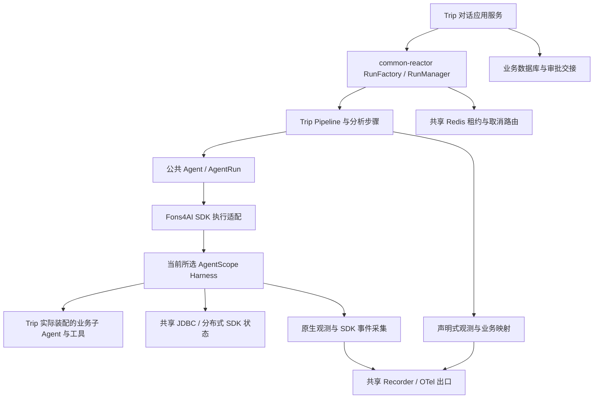
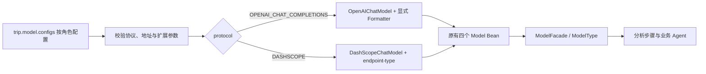

# Trip 如何接入框架，运行问题从哪里排查

[项目地图](index.md) · [会话生命周期](conversation.md) · [审批业务交接](agents-and-hitl.md) · [身份关联](data-and-identities.md)

Fons4AI 提供公共 Agent 协议、响应式运行、SDK 适配与观测；Trip 决定分析流程、业务 Agent、工具、事务与客户端交互。这里记录 Trip 的实际接入，框架通用机制在框架仓库单处解释。

## 当前依赖与装配边界

服务 POM 声明父工程 Fons4AI `1.0.0`，直接使用 `fons4ai-agentscope-starter`，并引入 DashScope/OpenAI 模型扩展与 Fons4Cloud 缓存、数据库、文件及认证组件。当前父工程声明 Java 21、Spring Boot 3.5.8、AgentScope 2.0.3；声明依赖不表示当前运行实例已加载某份本地修补产物。

图描述 Trip 当前选择 AgentScope 的实现。公共运行与观测契约本身不限定 SDK；更换框架需要重新核对实际适配与恢复能力，不能只替换依赖名。

`MasterAgentConfig` 用一个 `AgentScopeHarnessAgent` 包装 Master；三个业务子 Agent 是原生 HarnessAgent，分别配置 Toolkit。共用模型选择、时间上下文、原生 OTel/Fons 观测、活动 Agent 保存、共享存储和工作空间。子 Agent 另外装配执行生命周期与审批拒绝处理中间件，确保它们进入同一取消/恢复边界。

2026-10-28 R2.2 撤回本轮新增的框架权限策略接口及其运行上下文传递、许可覆盖和当前 DENY 恢复预检。固定工具规则只在 Trip 的 MasterAgentConfig 装配原生 permissionContext，执行许可继续由 SDK 处理；既有 Fons4AI 批次身份/Schema/CAS/防重与父子恢复不改。旧会话可以沿用保存的许可，新部署规则即时撤销旧审批不属于当前保证；具体配置与本轮验证状态见 [工具许可](agents-and-hitl.md#三种人工与审核语义)。

R2.3 的偏好简化只调整 Trip：页面与业务工具共用 CRUD，业务使用时按需查询；移除每次推理自动注入偏好及偏好原消息来源链，不新增框架采集、同步或恢复机制。原生记忆装配继续保留，业务默认优先于历史原生记忆，见[差旅偏好](travel-business.md#结构化差旅偏好与原生记忆)。

2026-11-08 记录：以精确提交 `c0d8ff4` 的导出为基线，在 Java 21.0.3、Maven 3.8.3 下离线生产编译成功，共 308 个生产源文件。本轮未编译或执行测试，未启动服务，HTTP/SSE 输出与供应商调用均未验证。`fons4cloud-common-web` 由用户自行引入；在真实依赖与运行验证之前，不声称 Trip 已启用其全局处理。

## 模型如何按协议装配

业务继续用 `ModelType` 和 `ModelFacade` 取得原来的四个 Spring Bean。`AgentModelConfiguration` 在启动时集中校验并装配客户端，不增加模型代理、注册中心或业务侧的供应商分支。

| 配置项 | 负责什么 |
| --- | --- |
| `protocol` | 选择 OpenAI Chat Completions 兼容客户端或 DashScope 原生客户端；旧配置未填写时默认 `DASHSCOPE` |
| `base-url`、`api-key`、`model-name` | 当前协议的地址、凭据和服务端模型 ID；不根据模型名称推断协议 |
| `message-format` | OpenAI 消息适配规则：`STANDARD`、`DEEPSEEK`、`GLM`，复用 SDK 已有 Formatter；原生 DashScope 只接受 `STANDARD` |
| `endpoint-type` | 仅适用于 DashScope 原生协议，可显式选择 `TEXT`、`MULTIMODAL` 或保留 `AUTO` |
| `extra-body` | 按供应商文档设置扩展参数。OpenAI 模式合入请求体顶层，不发送名为 `extra_body` 的嵌套字段；本版原生适配只映射 `enable_thinking` 到原生参数 |

当前配置把三个 DeepSeek 角色切到百炼 OpenAI 兼容协议，并使用 `DEEPSEEK` Formatter 保留工具轮次所需的思考历史兼容处理。`fast-model` 关闭思考，其余两个 DeepSeek 角色开启；`stable-model` 的 GLM 继续走原有 DashScope 文本端点。四个 Bean 名称及既有 `STRONG_THING_MODEL` 枚举拼写保持不变。

兼容协议地址优先取 `MODEL_CHAT_BASE_URL`，未设置时从原有百炼根地址 `MODEL_BASE_URL` 派生 `/compatible-mode/v1`；现有根地址应不带尾部斜杠或业务路径。SDK 最终拼接 `/chat/completions`。更换供应商时明确调整该角色的地址、凭据、模型、消息格式与扩展参数；百炼的 `enable_thinking` 与 DeepSeek 官方的 `thinking.type` 不属于可无条件互换的配置。

装配会在请求发出前拒绝空字段、无效地址、跨协议选项和覆盖 `messages`、`tools`、`stream` 等 SDK 管理字段的扩展配置；不在启动时联网探测模型能力。不提供自动跨供应商重试、热切换或 Responses 协议实现。切换配置后重启服务并使用新会话验证，旧供应商的待恢复会话不能据此视为可迁移。

服务商由地址、凭据与所选模型共同确定；当前没有独立 `provider` 配置字段，也没有增加 OTel provider 属性的业务重写。

2026-10-21 已通过生产编译和实际 YAML 的离线 Spring 装配检查：使用虚拟地址与凭据确认四个 Bean、消息格式、思考参数和兼容请求路径；没有新增或运行单元测试。真实 DeepSeek 响应、工具调用及 HITL 行为按下面的分场景记录核对，不能由离线装配推断通过。

| 2026-10-21 真实验收 | 结果与定位 |
| --- | --- |
| 短文本，不调用工具 | Run `TRT179257619833746b19b` 成功返回“收到”，DeepSeek 最终用量入库；未再出现原生端点的 HTTP 400 |
| 子 Agent 调用工具并经人工批准恢复 | 会话 `TRC179257627935746b19e`，首次 Run `TRT179257627946746b19f` 等待审批；恢复 Run `TRT179257646604046b1a2` 实际执行 `query_user_base_location` 并成功续推理，摘要只在恢复段记录该业务工具 |
| 普通续问补充部分日期 | Run `TRT179257661932346b1a5` 经 `agent_send` 进入同一子会话，只追问缺失的返程日期，正常展示 `INPUT_REQUIRED` 卡片 |
| 审批恢复后子节点请求补充 | 18:12 重启后，会话 `TRC179257769622888f75f` 的恢复 Run `TRT179257810044388f763` 成功产出并保存 `INPUT_REQUIRED`；实际模型摘要仅有子 Agent，父模型没有再次改写问题，修复路径通过 |
| 待补充状态整页刷新 | 同一恢复 Run 保存了 `extra.interactionKind=INPUT_REQUIRED` 和缺失日期字段，刷新后恢复底部输入提示；按用户意见移除这类交互的重复表单，仅在消息中展示一次追问。底部自然语言提交已通过 |
| 自然语言日期补充 | Run `TRT179257867057988f766` 已从底部接收“明天出发，大后天回来”，但前置 GLM 改写未取得有效 `rewritten_question`，在 Master 和日期解析之前失败；不能据此宣布相对日期续接通过 |
| 19:07 重启后的同一补充重发 | Run `TRT17925809230289f56bd` 的 GLM 改写与意图识别均返回有效结果；Master 进入原行程规划子会话，`memory_save` 待审批参数正确记录去程 `2026-10-22`、返程 `2026-10-24`，未搜索交通酒店或生成方案。已确认审批 `PENDING`、数据库执行占用清空；记忆保存和恢复后的最终答复待用户决定 |

该失败请求的日志确认 `glm-5.3` 使用原生 `TEXT` 端点；Langfuse 中改写输出为 `text=""`，记录用量为输入 1499、输出 78 Token。当前改写 Agent 只拼接 SDK `TextBlock`，而结果解析对非空原文有兜底，因此可以定位到业务层没有取得有效正文，不能仅根据异常文案认定只是 JSON 字段缺失。现有流式日志与 Trace 未保存原始响应片段或结束原因，尚不能区分供应商空正文、仅思考输出及 SDK 解析遗漏；需要片段类型、正文/思考长度与 `finishReason` 等诊断后再决定修复。日志“问题改写完成”位于有效性校验之前，也不能作为成功证据。

本轮仅使用测试账号的常驻城市只读查询，没有搜索交通酒店、生成方案或预订。截图和本地摘要在服务 `target/manual/model-protocol-e2e-20261021/`，该目录属于可清理的环境产物。多模态输入、完整行程规划、其他供应商与全部审批组合不在本轮验证范围。

界面已通过 Vite 更新。规划与 Master 提示词进一步明确自然语言补充、不要求固定日期格式，标准日期仅用于内部工具参数。19:07 重启后，新请求已在待审批工具参数中正确转换“明天出发、大后天回来”；记忆保存后的最终回复仍待审批恢复核对，不能把待审批参数当成已写入记忆。历史中的日期格式提示仍按原消息保留。

## 运行与 SDK 状态如何衔接

Pipeline 通过 `scope.relay(masterRun)` 接入 Master 的事件、权威结果、取消与退出确认。`ReactiveRunManager` 管理租约和取消句柄；SDK 内部节点与已准入工具是否退出，由执行适配汇总，不能以 `completion()` 或 SSE 结束释放业务执行权。

共享 `DistributedStore` 的 `agentStateStore()` 被显式传给父子 Agent；`enablePendingToolRecovery(false)` 避免隐式恢复悬空委派。框架有 DataSource 时可自动装配 JDBC 状态与分布式存储；数据库结构与 provider 的实际部署仍需核对，不能把状态存在本地对象里当作跨节点恢复依据。

本地分段审批方案保存父子状态，恢复时使用新 Run 重建执行，而非保持原子 Agent 实例一直等待。当前租约方案失效后请求取消，不具备业务写入 fencing、自动接管和完整的跨节点故障恢复保证。

## 执行摘要如何接入业务

公共 `AgentExecutionSummary` 描述本次分段的模型与工具调用事实，`AgentRunResult.getExecutionSummary()` 随结果返回；没有正常结果时，可在 `termination()` 完成后通过 `AgentRun.executionSummary()` 读取最终已知快照。正常完成与 `WAITING_APPROVAL` 都保留本段已有的 `completeInfo` 和摘要；是否完成由状态决定。未提供统计的适配器返回 null，不通过占位模型调用伪装成真实执行。通用契约在 Fons4AI `docs/agent-runtime.md` 单处维护，不绑定某个 SDK。

Trip 复用现有入口完成接入：

1. 问题改写和意图识别继续直接执行 Model；`ExtractUtils.usageMetadata()` 从真实响应取最终非空用量，Handler 在解析业务结果前存入原 Pipeline 上下文。缓存、规则命中和恢复跳过不复制历史模型消耗。
2. 当前 AgentScope 适配在已有生命周期中间件记录各节点模型最终 usage；ToolExecutor 的结果钩子包住通过校验后的真实工具调用，写入同一个 Run 上下文。SDK 本地固定补充问题响应不算供应商模型调用；原生压缩/记忆维护可能绕过模型事件，因此相应节点保守降低用量完整性。
3. `AgentPipelineExecuteContext.executionSummary()` 合并分析调用与 Master/子 Agent 的本段摘要，经 `PipelineResult` 进入原应用保存入口；真实退出时再从同一上下文补齐快照，覆盖取消后迟到的工具结果。没有新增 Pipeline 根采集器或模型代理。
4. `MasterAgentConfig` 从实际 Toolkit 构造 `TripToolCatalog`，业务投影只保留实际执行的已注册业务工具及 MCP 工具；内部委派、文件等调用保留在明细。业务 Guard 的 `TOOL_EXECUTED` 元数据区分防重短路，`TOOL_PROVIDER` 只来自可信返回来源，不能推算为供应商 HTTP 次数。

| 比较项 | 业务历史与执行摘要 | 可观测性 Trace |
| --- | --- | --- |
| 用途 | 会话刷新后的分析、工具、用量概况及后续任务看板的数据基础 | 排查步骤、模型和工具调用的身份、父子关系与耗时 |
| 产生入口 | 现有执行上下文、分段结果及退出收尾 | 注解、运行拦截器和 SDK 观测中间件 |
| 保存位置 | `chat_message` 与 `chat_request_trace` 的各自业务字段 | Recorder、JSONL、OTel/Langfuse 出口 |
| 权威边界 | 不读取观测出口，不依赖 Langfuse 回填业务结果 | 不作为会话占用、审批凭证或业务结果的权威来源 |

这里核实的是源码依赖与已完成的核心联调；关闭观测后的独立运行尚未单独验收。两表字段和历史读取分别见 [数据分工](data-and-identities.md#消息与请求摘要字段)、[会话时序](conversation.md#两表保存与历史读取)，避免在接入专题复制完整存储设计。

## 可观测性怎样接入业务

- Pipeline `run()` 声明 `@AgentObserved(kind=RUN)`；问题改写与意图识别的 Handler 声明 STEP，实际是否采集由业务 Convention 在订阅时判断。
- `TripObservationConvention` 使用请求的业务 `runId`、会话和用户固定身份，将 common-reactor ID 保存为 `pipelineRunId`；审批恢复同时关联 `originRunId`。
- Master/子 Agent 的原生 OTel 与 Fons 中间件补充 Agent、模型、工具与 HITL 节点。普通分析 Agent 可通过框架的 Tracer 桥接进入当前步骤；注解与 SDK 采集是组合关系。
- Run 终态来自业务结果：`WAITING_APPROVAL` 映射 `SUSPENDED`，不能因为响应式链返回结果就写成功。Trace 生命周期与执行权生命周期仍相互独立。

查一次请求时先获得业务 `runId` 与 `pipelineRunId`，再按实际导出的属性定位 Trace；`conversationId` 用于归并会话。不要把 Langfuse 页面中的每个 Observation 误认为一条独立用户请求，也不要仅凭 Trace 没有红色节点判断业务成功。

## 配置应在哪一处核对

| 配置入口 | 负责内容 |
| --- | --- |
| `trip.model` / `AgentModelConfiguration` | 模型类型、服务地址、模型名与凭据；当前 fast 关闭 thinking，其余装配依源码选择 |
| `trip.agent.master` | 工作空间、模型选择、推理轮次、工具超时/尝试、失败保护、委派与 ASK 工具集合 |
| `trip.agent.query-rewrite` / `trip.agent.intent-recognition` | 分析 Agent 配置 |
| `trip.mcp` 与其他供应商属性 | 端点、白名单、认证、初始化与请求超时，见外部工具专题 |
| `sys.reactor.run` | 当前框架默认租约 90 秒、心跳 20 秒、操作等待 5 秒、4 个检查线程；不代表运行环境没有覆盖 |
| `sys.agent.observability` | Recorder、JSONL、Langfuse 与 SDK Tracer 桥接开关；出口与密钥独立于业务身份 |

配置值集中查源文件和实际环境；Wiki 只保留用途和关键语义，不维护第二份运行配置。历史临时 `hitl-e2e` Profile 不能作为当前必需启动参数，需核对资源与已生效规则。

## SDK 兼容补丁与版本核查

当前框架包含 AgentScope 2.0.3 的最小同名源码补丁，例如工具执行生命周期和委派登记兼容处理。Trip POM 明确要求 starter 先于原 SDK 进入类路径；工具生命周期补丁有启动校验。

执行摘要复用该补丁的 `RESULT_INTERCEPTOR_ATTRIBUTE`，与取消准入的 `EXECUTION_INTERCEPTOR_ATTRIBUTE` 分开；启动校验同时检查标记与实际类来源。普通工具原始返回的默认 RUNNING 不能直接作为已结束的业务状态，适配在工具真实返回时规范化成功状态，并保留明确失败、挂起及短路。补丁细节继续在下方列出的框架 SDK 兼容说明目录维护，Trip 只记录装配和依赖边界。

升级时核对框架源码、依赖解析、实际 JAR 和类加载来源；`1.0.0` 同版本重新安装不说明服务已重启，也不能只靠源码新旧判断正在运行的类。依赖能力核查以真实公开接口、对应版本源码或产物为依据，不按名称猜 API。

## 按症状定位

| 现象 | 先查什么 |
| --- | --- |
| 刷新后不知道是否仍在执行 | 执行状态接口、数据库 active Run、租约；`UNKNOWN` 时不手工直接放行 |
| 停止后还调用工具 | 当前加载的生命周期适配/补丁、取消传播、已准入调用与真实退出；不要只看前端按钮 |
| 有审批文字但卡片不能提交 | PREPARED/PENDING、批次版本、完整消息集合与执行权交接 |
| 流式有思考，刷新后审批卡上方没有 | 分段结果 completeInfo、首条消息 thinking 与 extra.thinkingAgentName、历史映射；分析提示应查 analysis_content |
| 请求摘要仅有委派工具或不显示 Token | 区分旧历史与 v1 execution_summary；查实际业务工具清单、摘要结果传递、RequestTraceInfo 解析及 usageComplete，不能从模型正文补造 |
| 模型工具流解析异常 | 当前模型协议、SDK/修补产物、原始错误和适配边界；不要先修改业务数据 |
| Trace 缺步骤或父子关系错误 | 实际 STEP 是否执行、代理/Convention、SDK 采集装配、OTel 父上下文和出口 |
| 页面与方案或审核不一致 | 当前 owner、planId/reviewId、最新审核与发布资格，不只读 OSS 旧文件 |

## 资料与源码入口

- [服务 POM](../../fons4ai-trip-agent-service/pom.xml)、[Master 装配](../../fons4ai-trip-agent-service/src/main/java/com/fons/cloud/ai/trip/agent/core/MasterAgentConfig.java)、[Master 步骤](../../fons4ai-trip-agent-service/src/main/java/com/fons/cloud/ai/trip/agent/pipeline/support/MasterExecuteTaskStepHandler.java)。
- [模型装配](../../fons4ai-trip-agent-service/src/main/java/com/fons/cloud/ai/trip/infrastructure/config/AgentModelConfiguration.java)、[模型属性](../../fons4ai-trip-agent-service/src/main/java/com/fons/cloud/ai/trip/infrastructure/config/properties/ModelConfigProperties.java)、[协议枚举](../../fons4ai-trip-agent-service/src/main/java/com/fons/cloud/ai/trip/common/constants/ModelProtocol.java)、[消息格式](../../fons4ai-trip-agent-service/src/main/java/com/fons/cloud/ai/trip/common/constants/ModelMessageFormat.java)。
- [Master 属性](../../fons4ai-trip-agent-service/src/main/java/com/fons/cloud/ai/trip/infrastructure/config/properties/MasterAgentConfigProperties.java)、[TripObservationConvention](../../fons4ai-trip-agent-service/src/main/java/com/fons/cloud/ai/trip/infrastructure/observability/TripObservationConvention.java)。
- [Pipeline 上下文](../../fons4ai-trip-agent-service/src/main/java/com/fons/cloud/ai/trip/agent/pipeline/AgentPipelineExecuteContext.java)、[ExtractUtils](../../fons4ai-trip-agent-service/src/main/java/com/fons/cloud/ai/trip/infrastructure/util/ExtractUtils.java)、[工具清单](../../fons4ai-trip-agent-service/src/main/java/com/fons/cloud/ai/trip/agent/tool/TripToolCatalog.java)、[业务 Guard](../../fons4ai-trip-agent-service/src/main/java/com/fons/cloud/ai/trip/infrastructure/middleware/TripToolExecutionGuardMiddleware.java)：分段摘要的合并、业务分类与来源。
- 框架资料属于独立 [Fons4AI 仓库](https://github.com/nauyiq/fons4ai)：任务机制在 `docs/agent-runtime.md`，观测设计在 `docs/observability.md`，SDK 兼容说明在 `fons4ai-agent/fons4ai-agentscope-starter/docs/patches/`。当前工作空间从 `cloud/fons4ai/` 定位这些路径；独立克隆 Trip 时需另外取得匹配基线的框架资料，避免将兄弟仓库的本地路径当成仓库内链接。

本轮基线与运行验证范围统一见 [项目地图](index.md)。后续只核查受影响版本、装配与场景，不因一个依赖升级就重写整个 Wiki。
