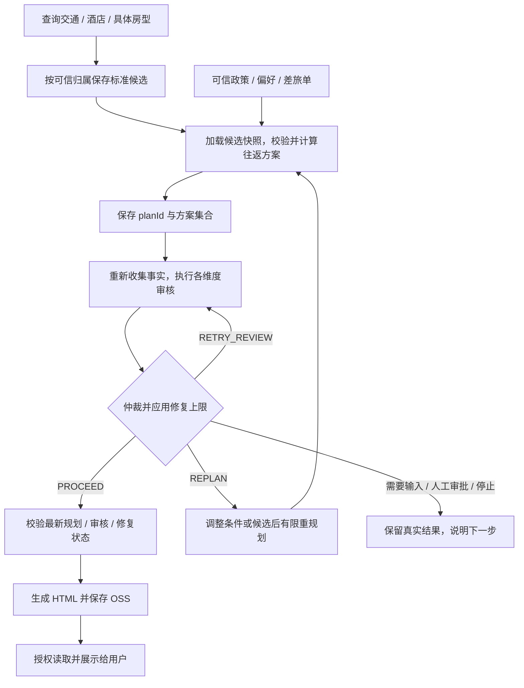

# 候选如何形成可审核、可展示的行程

[项目地图](index.md) · [外部工具](external-tools.md) · [业务政策](travel-business.md) · [归属与存储](data-and-identities.md)

行程规划 Agent 编排搜索和业务工具；规划应用服务基于已保存的标准候选与可信政策做客观计算，审核服务判断方案，页面服务检查发布资格后生成 HTML。这几步分别有结果和状态，不能用模型总结或任务清单代替它们。

## 从搜索到发布的主流程



这是工具与应用服务定义的业务流程，不表示模型在每次真实会话中都已经正确完成所有步骤。当前主要实现面向单目的城市的往返与住宿方案；多城市、无住宿等扩展场景不列为本次已验收能力。

## 候选与计算的可信输入

当前工作树中，普通查询和预算仅返回搜索结果；关联差旅单的搜索在核对当前用户及行程条件后保存候选。候选仓储按用户、差旅单和行程条件分组，每条结果从客户端获取时间起最多保留 30 分钟。同单改回原条件时，尚未过期的候选可以继续使用。规划读取对应的去返交通和住宿快照；调用方不能提交任意明细冒充供应商查询事实。该调整已进行生产编译，真实 Redis 过期和业务链路尚待验证，进度见[任务规划](../development/features/20261029-order-itinerary-scope/任务规划.md)。

规划应用服务不重新发起供应商搜索，也不渲染页面。其主步骤是参数/归属校验、关联差旅单核对、候选引用与排除项处理、过滤不可计算候选、生成时间有效的往返组合、费用耗时与评分计算、保存完整结果，再推进修复次数。

酒店列表起价不等于具体房型成本。价格口径 `UNKNOWN`、时间或必要报价字段不足时，不用默认值补成确定总价。缺少可计算的住宿候选可能使有住宿规划无法形成有效结果；这与外部查询成功并不矛盾。

## 审核完整性不等于业务通过

| 层次 | 值或含义 | 读结果时关注什么 |
| --- | --- | --- |
| 执行完整性 | `COMPLETE / PARTIAL / FAILED` | 必需审核维度是否真正形成结论 |
| 业务结论 | `PASS / WARNING / BLOCKED` | 方案是否合规、可行、有风险或阻断 |
| 下一动作 | `PROCEED`、`REPLAN`、`RETRY_REVIEW`、请求用户/人工、停止等 | 本轮流程实际应如何推进 |

当前定义差旅单一致性、政策合规、执行可行性、体验偏好、韧性五类审核维度；实际必需维度与审核器由规则集装配，不能只数类名就认定全部维度已启用或通过。

审核前重新读取关联差旅单当前状态，规划内旧快照只用于关联核对。单个审核器异常形成该维度未完成/失败记录，不阻止其他维度给出结果；最终由仲裁器汇总，而不是以审核调用正常返回就宣布可发布。

2026-10-21 的源码中，审核交通资讯已改为与对话工具共用 News 查询应用服务，在截取每城最多3条证据前完成城市/主题门槛与基础去重。无候选仍记资讯覆盖缺口，缺发布时间记元数据缺口，城市参数或供应商失败记查询失败，不推断交通正常。规则与数量含义见 [外部工具专题](external-tools.md#news-单页数量候选与去重)；目前生产编译通过，审核该分支尚待运行验证。

## 修复停止条件

`ItineraryRepairCycleValidatorService` 当前允许同一任务最多两次修复重规划，同一方案的审核不完整最多再重试一次。失败的规划计算或保存不消耗修复次数；规划保存、审核报告保存成功后才推进相应状态。

新方案应先审核，不能绕过待审核状态连续规划。等待用户输入或流程关闭时也不能在同一轮通过再次调用规划工具重置次数。`WARNING` 且已有推荐方案的 `PROCEED` 不强制自动修复；停止条件不能反过来篡改原审核事实。

## 页面发布再次验证什么

发布服务读取当前可信归属下的规划、最新审核和修复状态，同时要求：当前方案的修复循环已关闭，行程范围一致，审核 `COMPLETE` 且下一步为 `PROCEED`，推荐 ID 在规划及可推荐审核结果中都存在。

```text
用户 + 差旅单 + 会话 + planId -> 读取规划和修复状态
检查当前方案与行程范围 -> 读取最新审核
检查完整性、下一动作、推荐 ID 一致性
用同一快照渲染 HTML -> 保存对应 reviewId 的 OSS 对象
锁定差旅单并校验行程 -> 保存当前已发布快照
按登录用户和差旅单读取当前快照与页面
```

`CLOSED` 本身不等于审核通过，已有 OSS 页面也不等于当前允许展示。当前工作树按单保存最新已发布方案，生成页面成功且数据库提交后才通知聊天；用户可在“我的差旅”按订单读取。订单城市或日期修改时，同一事务删除已发布方案关联。旧独立会话方案保留只读入口；已关联订单的旧页面必须仍是该单当前已发布方案。上述 T-3 改造已完成编译和前端构建，尚待真实业务联调；客户端不会因为知道对象路径就获得任意方案访问权。

发布时先上传本次的 OSS 对象，再执行数据库事务；每次发布使用唯一对象路径，事务内校验发布条件并保存已发布快照与对象引用，不再改动 OSS。该顺序的限度是：OSS 上传成功不代表数据库提交成功，OSS 与数据库之间没有原子性保证；对象清理机制及失败场景尚待核实。读取已发布页面时，按数据库当前已发布快照校验审核完整性（`COMPLETE`、`PROCEED` 与推荐 ID 一致），OSS 对象的 review 元数据仅与该快照提供的 reviewId 比对，不一致时不作为当前页面返回；比对基准是已发布快照而非最新审核，尚未发布的新审核不会使旧已发布页面提前不可读。

页面展示查询时的报价快照，不代表目前价格、库存可用或已完成预订。完整规划与审核在各种真实供应商响应下的效果、全流程时延、用户修改和异常恢复仍需专门联调。

## 源码与验证入口

- [规划工具](../../fons4ai-trip-agent-service/src/main/java/com/fons/cloud/ai/trip/agent/tool/ItineraryPlannerTools.java)、[规划应用服务](../../fons4ai-trip-agent-service/src/main/java/com/fons/cloud/ai/trip/application/itinerary/ItineraryPlanApplicationService.java)、[候选仓储](../../fons4ai-trip-agent-service/src/main/java/com/fons/cloud/ai/trip/infrastructure/repository/ItineraryCandidateRepository.java)：候选快照与方案计算入口。
- [审核服务](../../fons4ai-trip-agent-service/src/main/java/com/fons/cloud/ai/trip/application/itinerary/ItineraryReviewApplicationService.java)、[审核编排](../../fons4ai-trip-agent-service/src/main/java/com/fons/cloud/ai/trip/application/itinerary/reviewer/ItineraryReviewOrchestrator.java)、[审核维度](../../fons4ai-trip-agent-service/src/main/java/com/fons/cloud/ai/trip/common/constants/ItineraryReviewDimension.java)：事实重新加载与仲裁。
- [修复校验器](../../fons4ai-trip-agent-service/src/main/java/com/fons/cloud/ai/trip/application/itinerary/validator/ItineraryRepairCycleValidatorService.java)、[发布资格校验器](../../fons4ai-trip-agent-service/src/main/java/com/fons/cloud/ai/trip/application/itinerary/validator/ItineraryPublicationEligibilityValidatorService.java)：停止与发布门禁。
- [页面应用服务](../../fons4ai-trip-agent-service/src/main/java/com/fons/cloud/ai/trip/application/itinerary/ItineraryPlanPageApplicationService.java)、[页面存储](../../fons4ai-trip-agent-service/src/main/java/com/fons/cloud/ai/trip/infrastructure/repository/ItineraryPlanPageStore.java)、[页面 Controller](../../fons4ai-trip-agent-service/src/main/java/com/fons/cloud/ai/trip/controller/ItineraryPlanPageController.java)。
- [已有行程测试](../../fons4ai-trip-agent-service/src/test/java/com/fons/cloud/ai/trip/application/itinerary/)：可阅读发布、修复和页面的场景定义，本轮未运行。
