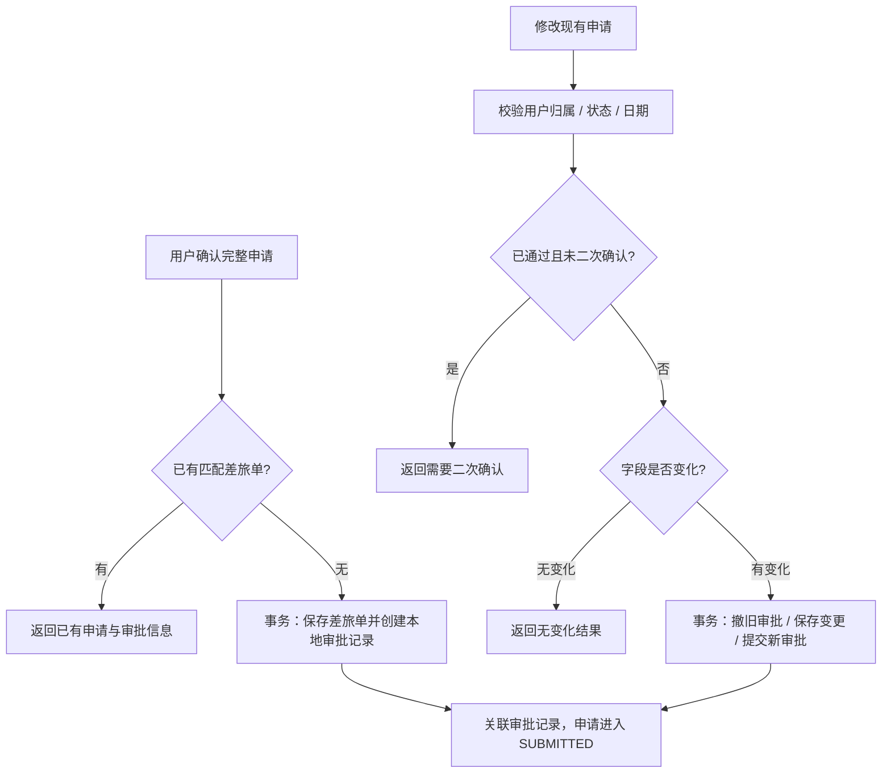

# 差旅单、业务审批与政策怎样衔接

[项目地图](index.md) · [工具许可](agents-and-hitl.md) · [行程审核](itinerary-planning.md)

行程管理 Agent 通过业务工具收集和确认参数，应用服务负责可信用户范围内的差旅单与审批记录。用户确认、工具执行许可、审批记录提交和最终审批通过是不同阶段。

## 创建与修改的事务边界

创建前的已有记录查找支持返回重复成功，但不能仅由这段查询推导全局并发幂等保证。修改省略或空白的字段保留原值，不表示清空字段；仅修改一端日期时仍与保留的另一端组合校验。

当前 `ApprovalRecordDomainServiceImpl.submit()` 创建并保存本地 `PENDING` 审批记录。`processInstanceId` 是这条业务记录的标识，不据此宣称已经接入外部 BPM 引擎或有完整审批操作端。现有查询入口可读取审批状态；最终批准的业务流程需单独定位并验收。

## 状态限制与风险确认

| 操作 | 已定位的主要限制 |
| --- | --- |
| 创建申请 | 需要可信用户和有效出行参数；保存申请、审批、关联关系在同一事务中处理 |
| 修改申请 | `CANCELLED`、`COMPLETED` 不允许修改；`APPROVED` 需 `force` 二次确认；日期不能倒置 |
| 取消申请 | 已取消不能重复取消，已完成不可取消；已通过需二次确认，随后由领域服务处理关联审批 |
| 查询申请与审批 | 按当前用户限定归属；多条差旅单匹配应让用户选择目标，空列表不等于系统失败 |
| 查询关联预订 | 读取当前用户与差旅单下有效记录，排除已取消或已退款记录；不是实时供应商下单 |

`TravelOrderStatus` 包含草稿、提交、通过、拒绝、完成、取消等值，但枚举存在不证明每个迁移都有可用接口。工具提示中的冲突检查、摘要确认等交互也应与实际调用核对，不能只看提示词就宣布强制保障已完整覆盖。

## 政策从哪里来，检查到什么程度

政策查询按用户档案中的职级、目的城市分级与 `TravelPolicyRule` 组合生成。城市分级来自配置，二线及其他城市映射到规则表的“其他”档，同时保留实际城市等级。缺职级、缺规则或规则非法会报错，不凭空生成默认标准。

`TravelPolicyApplicationService.checkCompliance()` 当前对单笔订单检查机票舱位、火车席别或酒店每晚金额；政策结果中存在星级、补贴、提前预订天数、审批阈值字段，不表示该方法已逐项校验它们。完整方案的多维审核另见 [规划专题](itinerary-planning.md)。

用户档案、常驻城市和联系人由用户信息工具读写。模型提出的用户、单号或档案内容需要按可信身份校验；不将上次规划中的快照直接当成当前业务状态。

## 已有实现与后续边界

当前业务 Agent 枚举和 Master 装配中没有独立预订 Agent，`BookingApplicationService` 主要提供关联记录查询。真实预订、支付、退款、重试和外部订单状态同步应作为独立业务能力评估，不由记录表或前端卡片推断完成。

本轮只核查上述源码，未执行申请写入、审批操作或预订。后续业务验收需要分别覆盖归属、重复请求、修改无变化、已通过二次确认、取消与事务失败，不能从只读查询通过扩大结论。

## 依据与入口

- [TravelBusinessApplicationService](../../fons4ai-trip-agent-service/src/main/java/com/fons/cloud/ai/trip/application/business/TravelBusinessApplicationService.java)：创建、修改、取消和订单聚合。
- [TravelOrderWriteTools](../../fons4ai-trip-agent-service/src/main/java/com/fons/cloud/ai/trip/agent/tool/TravelOrderWriteTools.java)、[读工具](../../fons4ai-trip-agent-service/src/main/java/com/fons/cloud/ai/trip/agent/tool/TravelOrderReadTools.java)、[冲突工具](../../fons4ai-trip-agent-service/src/main/java/com/fons/cloud/ai/trip/agent/tool/TravelOrderConflictTools.java)：业务入口与参数语义。
- [审批领域服务](../../fons4ai-trip-agent-service/src/main/java/com/fons/cloud/ai/trip/domain/service/impl/ApprovalRecordDomainServiceImpl.java)、[差旅状态](../../fons4ai-trip-agent-service/src/main/java/com/fons/cloud/ai/trip/common/constants/TravelOrderStatus.java)：本地审批与状态定义。
- [政策应用服务](../../fons4ai-trip-agent-service/src/main/java/com/fons/cloud/ai/trip/application/business/TravelPolicyApplicationService.java)、[政策配置](../../fons4ai-trip-agent-service/src/main/resources/travel-policy.yml)：政策来源与单笔检查范围。
- [BookingApplicationService](../../fons4ai-trip-agent-service/src/main/java/com/fons/cloud/ai/trip/application/business/BookingApplicationService.java)、[MyTravelController](../../fons4ai-trip-agent-service/src/main/java/com/fons/cloud/ai/trip/controller/MyTravelController.java)：有效预订记录与当前用户订单展示。
