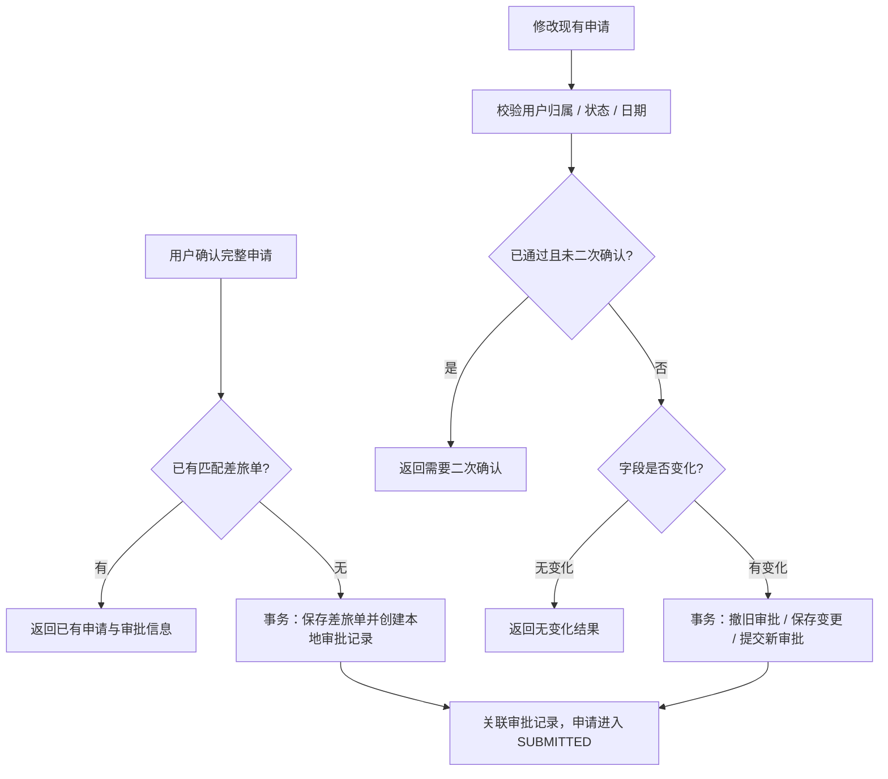
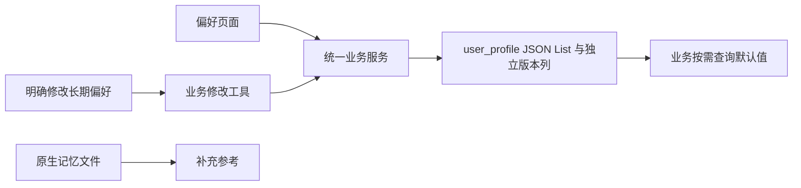

# 差旅单、业务审批与政策怎样衔接

[项目地图](index.md) · [工具许可](agents-and-hitl.md) · [行程审核](itinerary-planning.md)

行程管理 Agent 通过业务工具收集和确认参数，应用服务负责可信用户范围内的差旅单与审批记录。用户确认、工具执行许可、审批记录提交和最终审批通过是不同阶段。

## 创建与修改的事务边界

创建前的已有记录查找支持返回重复成功，但不能仅由这段查询推导全局并发幂等保证。修改省略或空白的字段保留原值，不表示清空字段；仅修改一端日期时仍与保留的另一端组合校验。

当前 `ApprovalRecordDomainServiceImpl.submit()` 创建并保存本地 `PENDING` 审批记录。`processInstanceId` 是这条业务记录的标识，不据此宣称已经接入外部 BPM 引擎或有完整审批操作端。现有查询入口可读取审批状态；最终批准的业务流程需单独定位并验收。

## 状态限制与风险确认

| 操作 | 已定位的主要限制 |
| --- | --- |
| 创建申请 | 需要可信用户和有效出行参数；保存申请、审批、关联关系在同一事务中处理 |
| 修改申请 | `CANCELLED`、`COMPLETED` 不允许修改；`APPROVED` 需 `force` 二次确认；日期不能倒置 |
| 取消申请 | 已取消不能重复取消，已完成不可取消；已通过需二次确认，随后由领域服务处理关联审批；该操作不代表取消外部预订或退款，关联记录供用户决定后续处理 |
| 查询申请与审批 | 按当前用户限定归属；多条差旅单匹配应让用户选择目标，空列表不等于系统失败 |
| 查询关联预订 | 读取当前用户与差旅单下有效记录，排除已取消或已退款记录；不是实时供应商下单 |

`TravelOrderStatus` 包含草稿、提交、通过、拒绝、完成、取消等值，但枚举存在不证明每个迁移都有可用接口。工具提示中的冲突检查、摘要确认等交互也应与实际调用核对，不能只看提示词就宣布强制保障已完整覆盖。

## 政策从哪里来，检查到什么程度

政策查询按用户档案中的职级、目的城市分级与 `TravelPolicyRule` 组合生成。城市分级来自配置，二线及其他城市映射到规则表的“其他”档，同时保留实际城市等级。缺职级、缺规则或规则非法会报错，不凭空生成默认标准。

`TravelPolicyApplicationService.checkCompliance()` 当前对单笔订单检查机票舱位、火车席别或酒店每晚金额；政策结果中存在星级、补贴、提前预订天数、审批阈值字段，不表示该方法已逐项校验它们。完整方案的多维审核另见 [规划专题](itinerary-planning.md)。

用户档案、常驻城市和联系人由用户信息工具读写。模型提出的用户、单号或档案内容需要按可信身份校验；不将上次规划中的快照直接当成当前业务状态。

## 结构化差旅偏好与原生记忆

2026-10-28 的 R2.3 将业务偏好收敛为页面 CRUD 与查询/修改工具共用一套读写服务，目录仍是出行方式、高铁席别、飞机舱等、座位位置、酒店星级、酒店特征及酒店房型。Master/行程管理可读写，规划/信息节点只读。原生保存、提取、整理和 Markdown 文件仍保留；业务默认优先于历史原生记忆，两条路径不做同步或时间仲裁。

目录编码、选项、分组与选择方式集中由 [PreferenceKey](../../fons4ai-trip-agent-service/src/main/java/com/fons/cloud/ai/trip/common/constants/PreferenceKey.java) 及关联枚举定义，PreferenceCatalog 只从枚举生成目录；[PreferenceData](../../fons4ai-trip-agent-service/src/main/java/com/fons/cloud/ai/trip/common/dto/preference/PreferenceData.java) 只声明带完整字段说明的 record。状态、操作和选择类型使用枚举，协议中的 key 和选项 value 仍沿用既有编码，数据库 JSON List 格式不变。SDK 2.0.3 对工具枚举使用 Java 常量名，因此 key 在协议边界保持字符串并统一交给枚举目录校验；不能直接将其 Schema 变成 TRANSPORT_MODE 等内部名称。

每项只保存 key/value/status/updatedAt，整份列表共用 preference_version 条件更新，一批只递增一次。兼容读取旧额外元数据，正常保存写四字段；不新增 DDL。清除保留 CLEARED，旧原生内容不自动补回。用户本次明确要求用于本次任务；明确修改长期默认时调用业务修改工具，页面与工具随后读到同一新值。memory_save 成功不代表业务已更新，企业政策、日期和真实库存仍是约束。

交通/酒店推荐与规划需要默认值时按需查询，不在每次推理自动注入；天气、资讯等无关任务不查偏好。规划须把实际采用的偏好传入现有 preferences/scores 并随方案保存，审核使用该快照；默认更新不自动改变既有差旅单、方案和待审批参数。出处核验、消息来源链和确认时间仲裁已退出本期。

入口为 [PreferenceApplicationService](../../fons4ai-trip-agent-service/src/main/java/com/fons/cloud/ai/trip/application/user/PreferenceApplicationService.java)、[偏好工具](../../fons4ai-trip-agent-service/src/main/java/com/fons/cloud/ai/trip/agent/tool/UserPreferenceTools.java) 和 [PreferenceController](../../fons4ai-trip-agent-service/src/main/java/com/fons/cloud/ai/trip/controller/PreferenceController.java)。现有两列迁移完成后随应用正常接入，不设单独开关。共享 travel-preferences.md 只在 Agent 装配时补充统一业务规则，不读库或逐次注入动态偏好；业务仍通过工具按需查询。构建、本地核对与真实页面/模型验收分开记录，进度见 [任务规划](../development/features/20261022-native-memory-preferences-permissions/任务规划.md)。

## 已有实现与后续边界

当前业务 Agent 枚举和 Master 装配中没有独立预订 Agent，`BookingApplicationService` 主要提供关联记录查询。真实预订、支付、退款、重试和外部订单状态同步应作为独立业务能力评估，不由记录表或前端卡片推断完成。

本轮只核查上述源码，未执行申请写入、审批操作或预订。后续业务验收需要分别覆盖归属、重复请求、修改无变化、已通过二次确认、取消与事务失败，不能从只读查询通过扩大结论。

## 依据与入口

- [TravelBusinessApplicationService](../../fons4ai-trip-agent-service/src/main/java/com/fons/cloud/ai/trip/application/business/TravelBusinessApplicationService.java)：创建、修改、取消和订单聚合。
- [TravelOrderWriteTools](../../fons4ai-trip-agent-service/src/main/java/com/fons/cloud/ai/trip/agent/tool/TravelOrderWriteTools.java)、[读工具](../../fons4ai-trip-agent-service/src/main/java/com/fons/cloud/ai/trip/agent/tool/TravelOrderReadTools.java)、[冲突工具](../../fons4ai-trip-agent-service/src/main/java/com/fons/cloud/ai/trip/agent/tool/TravelOrderConflictTools.java)：业务入口与参数语义。
- [审批领域服务](../../fons4ai-trip-agent-service/src/main/java/com/fons/cloud/ai/trip/domain/service/impl/ApprovalRecordDomainServiceImpl.java)、[差旅状态](../../fons4ai-trip-agent-service/src/main/java/com/fons/cloud/ai/trip/common/constants/TravelOrderStatus.java)：本地审批与状态定义。
- [政策应用服务](../../fons4ai-trip-agent-service/src/main/java/com/fons/cloud/ai/trip/application/business/TravelPolicyApplicationService.java)、[政策配置](../../fons4ai-trip-agent-service/src/main/resources/travel-policy.yml)：政策来源与单笔检查范围。
- [BookingApplicationService](../../fons4ai-trip-agent-service/src/main/java/com/fons/cloud/ai/trip/application/business/BookingApplicationService.java)、[MyTravelController](../../fons4ai-trip-agent-service/src/main/java/com/fons/cloud/ai/trip/controller/MyTravelController.java)：有效预订记录与当前用户订单展示。
